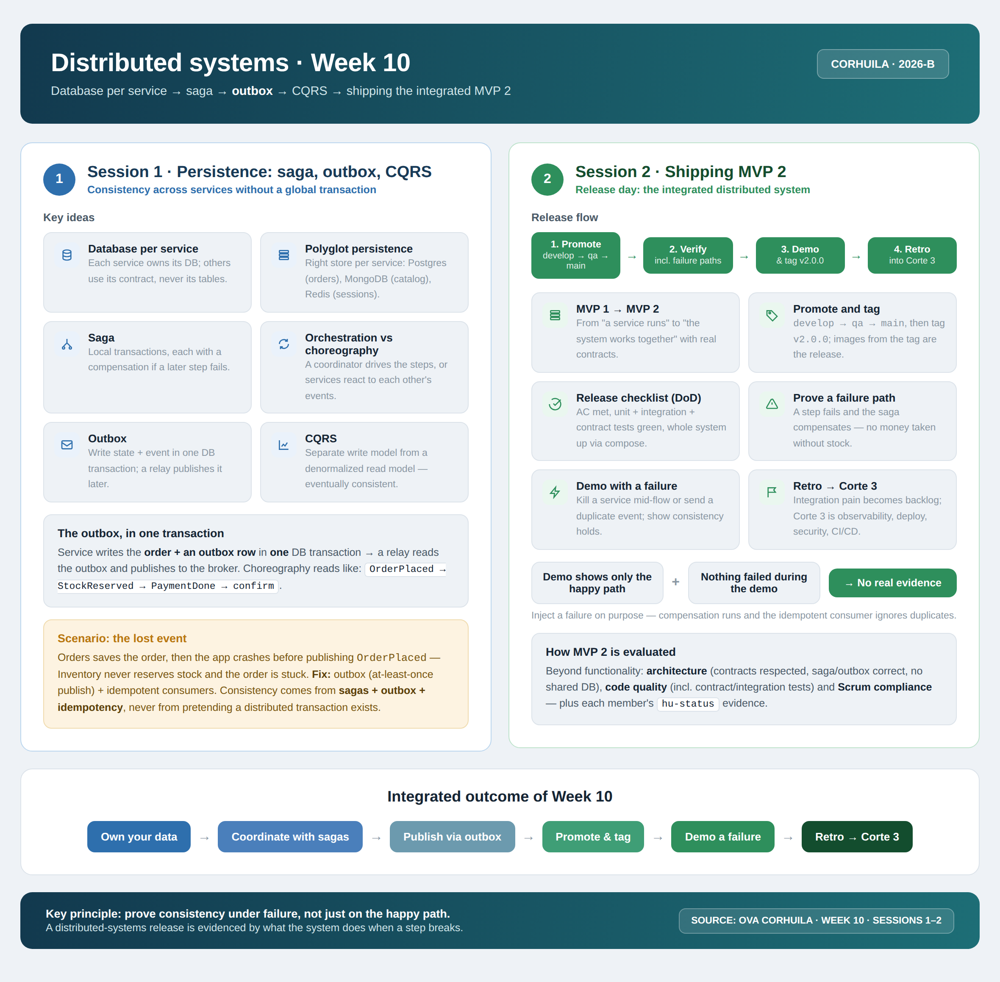

<!-- HU-STATUS TEMPLATE - do NOT remove the <!-- ... --> markers or the table headers.
     Your weekly grade is read AUTOMATICALLY from this file:
       10-week/hu-status/README.md  (inside YOUR fork). English. -->

# Weekly Status - Week 10

<!-- CONFIG-START - must match your profile repo (username/username) CONFIG -->
- FULL_NAME: Karen Johana Caicedo Arias
- GITHUB_USER: karencaicedo1907
- TEAM: CineSync Platform
- SPRINT_GOAL: Complete HU-FE-CATALOG-001 in csp-catalog-portal: synthetic catalog client, admin module, QA fixes, and release 2.0.0 promotion to main.
<!-- CONFIG-END -->

## 1. User stories worked this week
| HU ID | Title | Status (todo/doing/done) | Evidence (PR or commit URL) |
|---|---|---|---|
| HU-FE-CATALOG-001 | Build the CineSync catalog portal front end: synthetic catalog client, admin module, QA fixes, and release 2.0.0 | done | PRs #21–#54 (develop/qa) and PR #55 (release/2.0.0 -> main) |
| HU-FE-CATALOG-001 (sub-issue #35) | Administration module for billboard, movies, and rooms under `/admin/*` | done | PRs #38–#44 (develop) and PRs #45–#53 (qa) |

## 2. My individual contribution

**Main repository:** `code-corhuila/csp-catalog-portal`
**Additional repository:** `code-corhuila/csp-docs` (requirements documentation)

### 2.1 Executive summary

The full cycle of user story **HU-FE-CATALOG-001** was completed in `csp-catalog-portal`. First, the client side of the portal was built and consolidated (billboard, movie detail, and seat map on the `SYNTHETIC_CATALOG` dataset, with DRAFT state guards and CineSync branding). Then the **administration module** was developed in full (`/admin/*`): state and toast services, `AdminLayoutComponent` with contextual navigation, and the Billboard, Movies, and Rooms views. After that, the **defects found in QA** were addressed (hiding the global header on admin routes through the `isAdminRoute` signal, and safely disabling the "Reports" tab with `aria-disabled="true"`). Finally, the **promotion to `main` as release 2.0.0** was performed through the `release/2.0.0` branch with 16 byte-identical `-x` cherry-picks from `qa`, validated with 97/97 tests, clean lint and build, and published as **PR #55** (`release/2.0.0` -> `main`). The work respected the project Git-Flow (`develop` -> `qa` -> `release/2.0.0` -> `main`), with `-x` traceability on every promotion and no force-push at any point.

### 2.2 Period metrics (csp-catalog-portal)

| Metric | Value |
|---|---|
| Commits authored in the window (all refs, includes promotion duplicates) | **98** (53 as `Karen Caicedo` + 45 as `karencaicedo1907`) |
| Pull Requests opened by me | **31** |
| Merges made in `develop` | **15** |
| Merges made in `qa` | **14** |
| Cherry-picks in `release/2.0.0` | **16** (29 `-x` trailers) |
| Commits in `csp-docs` (agent session turns 86–162) | **154** |

### 2.3 Pull Request chronology

**Client phase — synthetic catalog (Oct 5–7)**

| Date | PR | From -> To | Content |
|---|---|---|---|
| 10-06 | **#21** | `feat/hu-fe-catalog-001-synthetic-data` -> `develop` | Synthetic module: billboard, detail, seat map, and DRAFT guards (merge `1402168`) |
| 10-06 | **#22** | feature -> `develop` | Widened test coverage for the synthetic catalog (merge `b98114a`; the merge title was wrongly cited as "#2" — flagged) |
| 10-06 | **#23** | `feat/hu-fe-catalog-001-billboard-branding` -> `develop` | Billboard UI and CineSync branding (merge `a93aaff`) |
| 10-07 | **#25** | `feat/hu-fe-catalog-001-movie-detail` -> `develop` | Detail: removes duplicated header, dynamic rating (merge `e6b406f`) |
| 10-07 | **#27** | `feat/hu-fe-catalog-001-seat-map` -> `develop` | Seat map cleanup and booking links (merge `5d1898c`) |
| 10-07 | **#28** (and **#30**, same branch `fix/catalog-movie-link-shell`) | `fix/...` -> `develop` | Relative routes for shell mounting — fixes the 404 when navigating to the detail (merge `3fc38b8`) |
| 10-06–07 | **#31, #32, #33, #34, #36, #37** | `qa-promote/...` -> `qa` | Promotions to `qa` of the previous PRs (merges in `qa` on 10-08: `b4dff1b`, `9423bea`, `38871b0`, `1c74f70`, `7e48b9c`, `3a7d1e4`) |

**Administration module phase — sub-issue #35 (Oct 8–10)**

| Date | PR develop | Date | PR qa | Content |
|---|---|---|---|---|
| 10-08 | **#38** -> `develop` (merge `58ac5fa`) | 10-08 | **#45** -> `qa` (merge `da90885`, 10-09) | `AdminCatalogStateService` + `AdminToastService` |
| 10-08 | **#39** -> `develop` (merge `e1fd996`) | 10-08 | **#46** -> `qa` (merge `1ec1aff`, 10-09) | Specs for the admin state service |
| 10-08 | **#40** -> `develop` (merge `c4e7eb9`, 10-09) | 10-09 | **#47** -> `qa` (merge `3d4fdc3`) | `AdminLayoutComponent` |
| 10-09 | **#41** -> `develop` (merge `ed860ef`) | 10-09 | **#48** -> `qa` (merge `c0b4ccb`) | Admin billboard view |
| 10-09 | **#42** -> `develop` (merge `e9a4b01`) | 10-09 | **#49** -> `qa` (merge `7eb36c1`) | Admin movies view |
| 10-09 | **#43** -> `develop` (merge `d5e6db0`) | 10-10 | **#50** -> `qa` (merge `5380cbb`) | Admin rooms view |
| 10-09 | **#44** -> `develop` (merge `cc158b7`) | 10-10 | **#51** -> `qa` (merge `65e9380`) | Module integration (routes, wiring) + specs |
| 10-10 | **#52** -> `develop` (merge `735803d`) | 10-10 | **#53** -> `qa` (merge `48e9ebe`) | **QA fixes**: standalone header hidden on admin routes + Reports tab disabled |
| 10-10 | **#54** -> `develop` (merge `890da01`) | (promoted in **#53**) | — | *Near-miss* test that blocks the header exact-segment check |

**Promotion to main (Oct 10)**

| Date | PR | From -> To | Content |
|---|---|---|---|
| 10-10 | **#55** | `release/2.0.0` -> `main` | Release **2.0.0**: 16 `-m 1 -x` cherry-picks of the 16 `qa` merges, byte-identical to `qa` (head `b1e3c67`) |

### 2.4 Reviews

- Short answers in English to the review bot findings on every PR.
- Explicit remediation commit: `daaba7d` *"fix(catalog): address automated review findings"*.
- Additional fixes coming from the review: `28e3064` (RouterLink for AOT), `83f905f` (rating check and spec formatting), `0c6b8dc` (dev port 4203, local).

### 2.5 Features and technical implementations

**Administration module development (HU-FE-CATALOG-001, sub-issue #35)**

Tree delivered in `src/app/catalog/admin/`:

| Component | File | Function |
|---|---|---|
| State and toasts | `data/admin-catalog-state.service.ts`, `data/admin-toast.service.ts` | Session-scoped in-memory copy of `SYNTHETIC_CATALOG`; admin CRUD and business rules (no deleting a movie or room with scheduled showtimes); resets on reload |
| Layout and navigation | `admin-layout.component.ts`, `admin.routes.ts` | Section sub-navigation with the ADMIN badge |
| **Billboard** `/admin/billboard` | `pages/admin-billboard-page.component.ts` | Schedule showtimes (automatic end time from movie duration, room conflict detection), list and delete them |
| **Movies** `/admin/movies` | `pages/admin-movies-page.component.ts` | Create and delete movies (title, genre, duration, rating, synopsis, trailer URL — all validated) |
| **Rooms** `/admin/rooms` | `pages/admin-rooms-page.component.ts` | Create and delete rooms with capacity; seat labels generated in rows of 8 |
| Reports `/admin/reports` | `pages/admin-reports-page.component.ts` | Metrics, occupancy, and showtime summary (mock); delivered but disabled in navigation (see 2.6) |
| Shell integration | `federation.config.js` | Module exposed as `./admin-routes`, mounted on `/admin/*` via `matcher` + shell `roleGuard('ADMIN')` |

**`AdminLayoutComponent` and contextual navigation**

- Section sub-navigation (**Billboard, Movies, Rooms**; **Billing** and **Reports** visible but disabled) with the **ADMIN** badge.
- On `/admin/*` the standalone portal header is hidden (`@if (!isAdminRoute())` in `app.component.ts`), so only the shell chrome and the module subnav remain (the remaining double header is the agreed design, Option A).
- Admin routes declared in `admin.routes.ts` and wired to the federated module.

**QA fixes (PRs #52/#54 in develop and #53 in qa)**

1. **Hiding the global header in standalone**: computed signal `isAdminRoute` in `src/app/app.component.ts` (line 63) evaluates the **exact** route segment; the site header is not rendered over `/admin/*`.
   - Hardened with *near-miss* tests (`admin-layout.component.spec.ts` and the header guard spec): routes like `/adminx` or prefixes that only look like `/admin` must **not** hide the header (PRs #53/#54).
2. **Safe disabling of the "Reports" tab**: `admin-layout.component.ts` line 257 renders `class="nav-link nav-link--disabled"`, **`aria-disabled="true"`**, and `title="Reports estará disponible en una próxima iteración"`; the test `admin-layout.component.spec.ts` line 46 asserts `getAttribute("aria-disabled") === "true"`.
   - Reason: the shell `catalogAdminMatcher` does not include `reports`, so that address would 404 when mounted in the shell; the page and its route remain intact and reachable in standalone. Reopening it must happen **first in the shell** (`CATALOG_ADMIN_AREAS`) and then in this portal.

**Client side**

- Billboard (`/`), movie detail (`/movies/:movieId`), and seat map (`/showtimes/:showtimeId/seats`, 48 seats A1–F8 with deterministic availability) on `SYNTHETIC_CATALOG` (5 published movies, 1 DRAFT, 8 showtimes).
- DRAFT movies hidden from the service layer (billboard and direct URL access).
- Routes corrected to **relative** for shell mounting (`['movies', id]`, back `../`), removing the 404 when navigating from the shell.
- CineSync branding and dark theme per `12-ux-ui/mockup/index.html` (HU-UI-001).

### 2.6 Tests and quality

Verified execution over `release/2.0.0` (= `qa`):

| Verification | Result |
|---|---|
| Unit tests (Karma/Chrome Headless) | **97/97 SUCCESS** — `TOTAL: 97 SUCCESS` |
| Coverage (minimum 80%) | Statements **95.76%** (294/307) · Branches **86.2%** (100/116) · Functions **93.93%** (93/99) · Lines **96.48%** (247/256) |
| Lint | `All files pass linting.` ✅ |
| Build | `ng build` ✅ (3.811 s) |
| Byte-for-byte identity | `git diff origin/qa origin/release/2.0.0` -> **empty** |
| Branch CI | workflow `build-and-test` must be green before the merge (run id to be reported in PR #55) |

> **Note on the count:** the current suite is **97/97** (measured today); if a previous report shows 96, the final number to cite is 97. The specs grew 40 → 60 → 70 → 77 → 85 → 94 → **97** during the period.

Coverage of the new specs in the period: `admin-catalog-state.service.spec.ts`, `admin-layout.component.spec.ts` (includes the near-miss), `admin-billboard-page.component.spec.ts`, `admin-movies-page.component.spec.ts`, `admin-rooms-page.component.spec.ts`, `admin-reports-page.component.spec.ts`, plus the client-side ones (`billboard-page`, `movie-detail-page`, `seat-map-page`, `synthetic-catalog-data.service`).

### 2.7 Governance and traceability

**Branch flow (project Git-Flow):**

```
feature/* + fix/* ──PR──▶ develop ──cherry-pick -x──▶ qa ──cherry-pick -m 1 -x──▶ release/2.0.0 ──PR #55──▶ main
                            (15 merges)                 (14 merges)                   (16 commits)
```

- **Re-application, never merging between lanes:** every promotion used `git cherry-pick -x` (and `-m 1 --empty=keep` from `qa`, because the `qa` merges have two parents), leaving the `(cherry picked from commit <sha>)` trailer in the commit body.
- **Full traceability:** `grep -c 'cherry picked from commit'` over `origin/main..origin/release/2.0.0` = **29 trailers in 16 commits**; the trail documented in PR #55 with the 16 `origin -> destination` pairs linked.
- **No force-push:** branches were updated with `git fetch origin <branch>:<branch>` and pushes followed the up-to-5-attempts protocol with confirmation via `git ls-remote` (verified: `b1e3c671b7f2d5bedd1c305b1ab11740f8e052c5 refs/heads/release/2.0.0`).
- **Titles and conventions:** Conventional Commits in every message; merge titles in the format `<type>(<lane>): merge PR #NN - <description>`; `qa` merge titles cite the source `develop` PR number; `Refs: #6` (HU) and `Refs: #35` (admin sub-issue) instead of `Closes` for stories.
- **Traceability issues:** story `#6` (HU-FE-CATALOG-001); client-side sub-issues `#16–#20`, `#26`; admin sub-issue `#35`. (Confirmed: those numbers have no `refs/pull` in the repo, i.e. they are issues and not PRs.)
- **400-line limit (section 9.2):** does not apply to promotions to `main` by course instruction; the size was reported anyway: 22,603 lines in 48 files (1,613 specs + 17,793 generated `package-lock.json`) -> **3,197 lines counted**.
- **Working-tree hygiene:** `package.json` with `"start": "ng serve --port 4203"` and `tsconfig.federation.json` (Windows artifact with backslashes) remain **uncommitted**; the `release/2.0.0` push did not include them (`git diff origin/release/2.0.0` only shows those two local files).

**Additional repositories reviewed:** in the window there are no commits of mine in `csp-front` nor `csp-auth-portal` (the activity on those dates belongs to Oscar Sierra, teammate); in `csp-docs` there are **154** documentation commits (agent session turns 86–162, Oct 5–8) under my authorship. `cinesync-mockup`, `csp-booking-portal`, and `csp-concessions-portal` show no activity of mine in the period.

## 3. Blockers and risks

- The "Reports" tab is intentionally disabled in the admin navigation because the shell `catalogAdminMatcher` does not include `reports`; re-enabling it requires updating `CATALOG_ADMIN_AREAS` in the shell **before** re-opening the tab in this portal, otherwise the address would 404 when mounted in the shell.
- One `qa` merge title of PR #22 was cited as "#2" by mistake (flagged); the content and trail are correct, but the title should be corrected or annotated in the final review to keep the audit clean.
- The branch CI run (`build-and-test`) for `release/2.0.0` must be confirmed green before the PR #55 merge; the run id is still to be reported in the PR description.
- Local-only artifacts (`package.json` dev port 4203 and `tsconfig.federation.json` with Windows backslashes) must stay uncommitted; if they leak into a feature branch they would pollute the review and the release diff.
- The admin module state is in-memory and session-scoped by design; integrating it with the real catalog API is still pending, so any demo must be explicit that data resets on reload.

## 4. Plan for next week

- Monitor the PR #55 review, report the CI `build-and-test` run id in the PR description, and confirm the release 2.0.0 merge to `main` once approved.
- Coordinate with the shell repository to add `reports` to `CATALOG_ADMIN_AREAS`, and only then re-enable the "Reports" tab in the portal (first in the shell, then in this portal).
- Connect the catalog portal and the admin module to the real catalog API contracts, replacing the in-memory `SYNTHETIC_CATALOG` service.
- Keep the Git-Flow discipline (`develop` -> `qa` -> `release` -> `main`) with `-x` cherry-picks and no force-push for the next increments.
- Address any remaining review-bot findings and keep the working tree free of local-only artifacts.

## 5. Compliance self-check
- [x] Conventional Commits - `type(scope): summary`
- [x] Per-environment HU branch + PR to that environment (hu-xxx-dev -> develop, ...)
- [x] Testable acceptance criteria
- [x] Tests added/updated (unit / integration)
- [x] DDD / hexagonal boundaries respected (domain has no I/O)
- [x] No secrets; config via environment variables

## 6. Evidence links

- Main repository: `code-corhuila/csp-catalog-portal`
- Additional repository: `code-corhuila/csp-docs` (154 documentation commits in the period)
- Client phase PRs: #21, #22, #23, #25, #27, #28/#30 to `develop`; #31, #32, #33, #34, #36, #37 to `qa`
- Admin module PRs: #38–#44 to `develop`; #45–#53 to `qa`
- QA fixes PRs: #52/#54 (`develop`), #53 (`qa`)
- Release promotion: PR #55 (`release/2.0.0` -> `main`), 16 `-x` cherry-picks, head `b1e3c67`
- Traceability: story issue #6, client sub-issues #16–#20 and #26, admin sub-issue #35

### Week 10 work summary

The user story HU-FE-CATALOG-001 was completed in `csp-catalog-portal`. The client side of the portal was delivered first: a billboard, a movie detail view, and an interactive seat map over the `SYNTHETIC_CATALOG` dataset, with DRAFT-state guards that hide unpublished movies from both the billboard and direct URL access, relative routes for mounting under the shell, and CineSync branding with the dark theme from the UX mockup.

The administration module was then delivered in full under `/admin/*`: session-scoped state and toast services with admin CRUD and business rules (a movie or room with scheduled showtimes cannot be deleted), an `AdminLayoutComponent` with contextual sub-navigation and the ADMIN badge, and the Billboard, Movies, and Rooms views for scheduling showtimes with automatic end times and room conflict detection, creating and deleting movies with full validation, and managing rooms with generated seat labels. The module is exposed as `./admin-routes` through Native Federation and mounted on `/admin/*` with the shell `roleGuard('ADMIN')`.

Two QA defects were fixed and hardened with tests: the standalone portal header is now hidden on admin routes through the exact-segment `isAdminRoute` signal (with *near-miss* tests proving that lookalike routes such as `/adminx` do not hide it), and the "Reports" tab is safely disabled with `aria-disabled="true"` because the shell matcher does not yet include `reports`.

Finally, the delivery was promoted to `main` as release 2.0.0 through the `release/2.0.0` branch, using 16 `-m 1 -x` cherry-picks of the 16 `qa` merges, byte-identical to `qa` and validated with 97/97 unit tests, clean lint, a successful build, and 29 `cherry picked from commit` trailers for full traceability, published as PR #55. The whole period followed the project Git-Flow without any force-push.

### Week 10 summary session 1-2:


