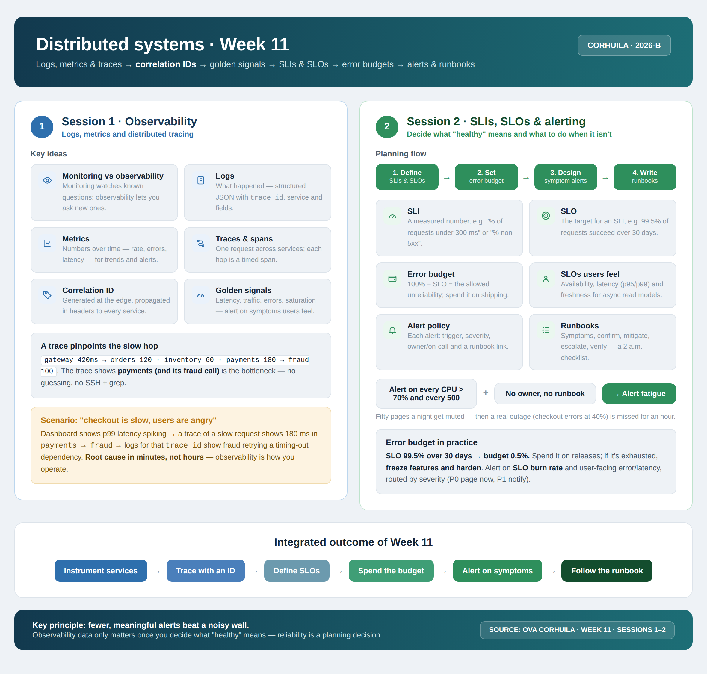

<!-- HU-STATUS TEMPLATE - do NOT remove the <!-- ... --> markers or the table headers.
     Your weekly grade is read AUTOMATICALLY from this file:
       11-week/hu-status/README.md  (inside YOUR fork). English. -->

# Weekly Status - Week 11

<!-- CONFIG-START - must match your profile repo (username/username) CONFIG -->
- FULL_NAME: Karen Johana Caicedo Arias
- GITHUB_USER: karencaicedo1907
- TEAM: CineSync Platform
- SPRINT_GOAL: Release HU-FE-CATALOG-001 as Release 2.0.0, close the deploy/CORS follow-up as 2.0.1, and consolidate the Cut 2 evidence for the catalog, concessions, and docs repositories.
<!-- CONFIG-END -->

## 1. User stories worked this week
| HU ID | Title | Status (todo/doing/done) | Evidence (PR or commit URL) |
|---|---|---|---|
| HU-FE-CATALOG-001 | Release the CineSync catalog portal as 2.0.0 and close the release train (changelog, dev port, compose, CORS, 2.0.1 hotfix) | done | PR #55 (release/2.0.0 -> main), PRs #56–#63 and #65; issue #6 closed 13 Oct; tags `v2.0.0` and `v2.0.1` |
| HU-FE-CONCESSIONS-001 | Promote the Concessions portal to main and publish release 2.0.0 | done | PR #48 by `Oscarsl10` (merge `e06395c`), tag `v2.0.0` published 11 Oct; my base scaffold = PRs #1–#5 |
| HU-UI-001 / HU-UI-002 | Billboard branding and detail/seat-map flows included in the 2.0.0 release | done | Included in `release/2.0.0` promoted by PR #55 |
| W11-WORKSHOP | Observability workshop, delivery 1: journey, log contract, instrumentation and metric catalog | done | `11-week/workshop/` commits listed in section 2.8 |

## 2. My individual contribution

### 2.1 Executive summary

Week 11 was the release week of the Cut 2 cycle. In `csp-catalog-portal`, the complete **Release 2.0.0 train** was finished: HU-FE-CATALOG-001 was promoted to `main` through **PR #55** (`release/2.0.0` -> `main`, merge `fc2ce34`, containing the 16 `-m 1 -x` cherry-picks byte-identical to `qa` with head `b1e3c67`) and published as tag/release **`v2.0.0`** on October 11; the release changelog was added in `develop` and `qa` (**PRs #57/#58**) and promoted to `main` (`b97ffca`). The remaining release-week work closed the follow-ups: the dev port 4203 promotion (**PR #56**), the container published as `4203:80` on the `csp-frontend` network (**PR #59**), and the CORS rule answered from `CORS_ALLOWED_ORIGIN_REGEX` with the anchoring enforced in the entrypoint and CI (**PRs #60/#61**, closing issue **#29** per ADR-026). Finally, the changelog was closed for **2.0.1** (**PRs #62/#63**) and `release/2.0.1` was promoted to `main` (**PR #65**, merge `33d88b0`) and published as tag **`v2.0.1`** on October 13, closing the deploy/CORS hotfix train. In parallel, **`csp-concessions-portal` published release `v2.0.0`** on October 11 (promotion PR #48 by teammate `Oscarsl10`, tag -> `e06395c`), which includes the governance/federation/runtime/domain/CI scaffold I delivered in PRs #1–#5. In `csp-docs` I had no commits or PRs in the window (last one: `d7e98b9`, October 8). Totals for the window: **24 commits and 10 Pull Requests, all in `csp-catalog-portal`**.

### 2.2 Week 11 matrix — consolidated state

| Repository | Commits by me | develop | qa | main | PRs opened by me | Releases in window | HU status |
|---|---|---|---|---|---|---|---|
| `csp-catalog-portal` | **24** | 10 | 9 | 5 | **10** (#55–#58, #59–#63, #65) | `v2.0.0` (11/Oct), `v2.0.1` (13/Oct) | HU-FE-CATALOG-001 **done / released** (issue #6 closed 13/Oct) |
| **Week 11 total** | **24** | 10 | 9 | 5 | **10** | 1 releases | — |

Verified against the branch totals of the period: develop 54 · qa 42 · main 20 (the Week 11 slice is included in them). Commits on 14–17 Oct: **0** in `csp-catalog-portal` (any author) and **0** in `csp-concessions-portal` (any author).

### 2.3 Week 11 commits — `csp-catalog-portal` (24)

| Date | Branch | SHA | Message |
|---|---|---|---|
| 11/Oct | develop | `d3d4dd1` | docs(catalog): merge PR #57 - add the changelog for release 2.0.0 |
| 11/Oct | develop | `79b3c20` | docs(catalog): add the changelog for release 2.0.0 #6 |
| 11/Oct | qa | `4ee410c` | docs(qa): merge PR #58 - add the changelog for release 2.0.0 *(cherry-pick `-x` of `79b3c20`)* |
| 11/Oct | qa | `76fcee9` | docs(catalog): add the changelog for release 2.0.0 #6 *(cherry-pick `-x` of `79b3c20`)* |
| 11/Oct | main | `fc2ce34` | feat(catalog): merge PR #55 - promote HU-FE-CATALOG-001 as release/2.0.0 |
| 11/Oct | main | `b97ffca` | docs(qa): merge PR #58 - add the changelog for release 2.0.0 *(cherry-pick `-x` of `79b3c20`)* |
| 12/Oct | develop | `860107c` | fix(catalog): publish the container as 4203:80 on the csp-frontend network #6 |
| 12/Oct | develop | `e24f354` | fix(catalog): merge PR #59 - publish the container as 4203:80 on the csp-frontend network |
| 12/Oct | develop | `842dcde` | fix(catalog): answer CORS from CORS_ALLOWED_ORIGIN_REGEX as the other portals do #29 |
| 12/Oct | develop | `f636aa9` | fix(catalog): enforce the CORS anchoring in the entrypoint and CI #29 |
| 12/Oct | develop | `b8229b8` | fix(catalog): lock the CORS anchoring in CI and docs #29 |
| 12/Oct | qa | `44ed648` | fix(catalog): publish the container as 4203:80 on the csp-frontend network #6 *(cherry-pick `-x` of `860107c`)* |
| 12/Oct | qa | `8c3379b` | fix(catalog): answer CORS from CORS_ALLOWED_ORIGIN_REGEX as the other portals do #29 *(cherry-pick `-x` of `842dcde`)* |
| 12/Oct | qa | `8fe71d6` | fix(catalog): enforce the CORS anchoring in the entrypoint and CI #29 *(cherry-pick `-x` of `f636aa9`)* |
| 12/Oct | qa | `3fa070b` | fix(catalog): lock the CORS anchoring in CI and docs #29 *(cherry-pick `-x` of `b8229b8`)* |
| 13/Oct | develop | `219455d` | docs(catalog): merge PR #62 - close release 2.0.1 in the changelog |
| 13/Oct | develop | `f2326af` | docs(catalog): close release 2.0.1 in the changelog #6 |
| 13/Oct | develop | `84baf03` | fix(catalog): merge PR #60 - answer CORS from CORS_ALLOWED_ORIGIN_REGEX as the other portals do |
| 13/Oct | qa | `ce80257` | docs(qa): merge PR #63 - close release 2.0.1 in the changelog *(cherry-pick `-x` of `f2326af`)* |
| 13/Oct | qa | `b0f66ed` | docs(catalog): close release 2.0.1 in the changelog #6 *(cherry-pick `-x` of `f2326af`)* |
| 13/Oct | qa | `415f23f` | fix(qa): merge PR #61 - promote the compose 4203:80 and CORS ADR-026 fixes to qa *(cherry-pick `-x` of `860107c`)* |
| 13/Oct | main | `33d88b0` | fix(catalog): merge PR #65 - promote release/2.0.1 to main |
| 13/Oct | main | `50c5b86` | docs(qa): merge PR #63 - close release 2.0.1 in the changelog *(cherry-pick `-x` of `f2326af`)* |
| 13/Oct | main | `bef8374` | fix(qa): merge PR #61 - promote the compose 4203:80 and CORS ADR-026 fixes to qa *(cherry-pick `-x` of `860107c`)* |

Branch totals for Week 11: **develop 10 · qa 9 · main 5 = 24** (13 of them cherry-picks `-x`: 9 to `qa`, 4 to `main`; `fc2ce34` is the regular merge of PR #55).

### 2.4 Week 11 Pull Requests (10, all opened by `karencaicedo1907` and all merged)

| PR | Created | Merged | Title | Base | Merge commit |
|---|---|---|---|---|---|
| #55 | 2026-10-11 | 2026-10-11 | feat(catalog): promote HU-FE-CATALOG-001 as release/2.0.0 | main | `fc2ce34` |
| #56 | 2026-10-11 | 2026-10-11 | chore(qa): move the portal dev port to 4203 | qa | `a199ec6` (commit dated 10/Oct local time, see 2.7) |
| #57 | 2026-10-11 | 2026-10-11 | docs(catalog): add the changelog for release 2.0.0 | develop | `d3d4dd1` |
| #58 | 2026-10-11 | 2026-10-11 | docs(qa): add the changelog for release 2.0.0 | qa | `4ee410c` |
| #59 | 2026-10-13 | 2026-10-13 | fix(catalog): publish the container as 4203:80 on the csp-frontend network | develop | `e24f354` |
| #60 | 2026-10-13 | 2026-10-13 | fix(catalog): answer CORS from CORS_ALLOWED_ORIGIN_REGEX as the other portals do | develop | `84baf03` |
| #61 | 2026-10-13 | 2026-10-13 | fix(catalog): promote the compose 4203:80 and CORS ADR-026 fixes to qa | qa | `415f23f` |
| #62 | 2026-10-13 | 2026-10-13 | docs(catalog): close release 2.0.1 in the changelog | develop | `219455d` |
| #63 | 2026-10-13 | 2026-10-13 | docs(qa): close release 2.0.1 in the changelog | qa | `ce80257` |
| #65 | 2026-10-13 | 2026-10-13 | fix(catalog): promote release/2.0.1 to main | main | `33d88b0` |

### 2.5 User stories and issues — status after Release 2.0.0

| Story / Issue | Repository | Status in Week 11 | Evidence |
|---|---|---|---|
| **HU-FE-CATALOG-001** (issue #6) | catalog | **done — released in 2.0.0**; issue **closed 13 Oct** | PR #55, tag `v2.0.0`, changelog PRs #57/#58 |
| Sub-issue #35 — administration module | catalog | done — closed 09 Oct, included in release 2.0.0 | PRs #38–#44 (develop), #45–#51 (qa), #52/#53/#54 (QA fixes) |
| **HU-UI-001 / HU-UI-002** | catalog | done — included in release 2.0.0 | Billboard/branding and detail/seat-map PRs of the previous week |
| Issue #29 — CORS per ADR-026 | catalog | **closed 13 Oct** | PRs #60 (develop, `84baf03`) and #61 (qa, `415f23f`); commits `842dcde`, `f636aa9`, `b8229b8` |
| Issue #64 — container healthcheck resolves `::1` | catalog | **open** (opened 13 Oct by `Oscarsl10`) — teammate's deploy issue, not mine | — |
| **HU-FE-CONCESSIONS-001** | concessions | **done — released in 2.0.0** (11 Oct) | PR #48 by `Oscarsl10` -> `main` (`e06395c`), tag `v2.0.0`; my scaffold PRs #1–#5 are part of the released baseline |

### 2.6 Technical advances of the release train

- **Release 2.0.0:** `release/2.0.0` promoted to `main` through PR #55 with the 16 `-m 1 -x` cherry-picks byte-identical to `qa` (head `b1e3c67`), published as **`v2.0.0`** on 11 Oct by `karencaicedo1907`; the release changelog was added in `develop` (#57) and `qa` (#58) and promoted to `main` (`b97ffca`).
- **Dev port:** PR #56 promoted the portal dev port to 4203 into `qa`.
- **Compose:** PR #59 published the container as `4203:80` on the `csp-frontend` network (Refs #6).
- **CORS:** PRs #60/#61 answer CORS from `CORS_ALLOWED_ORIGIN_REGEX` the same way as the other portals and enforce the anchoring in the entrypoint and CI — issue **#29 closed 13 Oct** (ADR-026).
- **Release 2.0.1:** changelog closed for 2.0.1 (#62/#63) and `release/2.0.1` promoted to `main` (#65) -> tag **`v2.0.1`** (13 Oct), closing the deploy/CORS hotfix train.
- **Concessions:** release **`v2.0.0`** published 11 Oct through promotion PR #48 by `Oscarsl10`; no commits or PRs by me in the window — my governance/federation/runtime/domain/CI scaffold (PRs #1–#5) is part of the released baseline.
- **Docs:** no commits or PRs by me in Week 11 (last one: `d7e98b9`, 08 Oct). Teammates recorded the release-related status updates, e.g. `3b0f909` "mark the four Booking stories as done in main" and `42fc9d5` "update the status of the Auth and Concessions stories" (Yeferson, 11 Oct).

### 2.8 Workshop W11 - delivery 1 (CP0 to CP4)

Individual observability workshop on the journey "schedule and publish a showtime" (`api-gateway` -> `catalog-service` -> MongoDB `outbox_event` -> `csp-worker` -> RabbitMQ). Work is in `11-week/workshop/`.

| Checkpoint | Commit | Message | Content |
|---|---|---|---|
| CP0 | [`0614a73`](https://github.com/karencaicedo1907/sistemas-distribuidos-2026-b-g1/commit/0614a73) | docs(w11): start observability workshop | workshop README with CONFIG |
| CP0 | [`9b2a886`](https://github.com/karencaicedo1907/sistemas-distribuidos-2026-b-g1/commit/9b2a886) | docs(w11): add reflection document link to workshop readme | README fix: full name and reflection document |
| CP1 | [`e79fbb6`](https://github.com/karencaicedo1907/sistemas-distribuidos-2026-b-g1/commit/e79fbb6) | docs(w11): map critical journey and trace propagation | `01-journey.md`: showtime publication journey, Mermaid, span tree |
| CP2 | [`27c1f61`](https://github.com/karencaicedo1907/sistemas-distribuidos-2026-b-g1/commit/27c1f61) | docs(w11): define structured log contract | `02-log-contract.md`: fields, never-log list, seven log lines, levels |
| CP3 | [`8d87764`](https://github.com/karencaicedo1907/sistemas-distribuidos-2026-b-g1/commit/8d87764) | feat(w11): add trace-context middleware and structured logger | `TraceContext`, `TraceContextMiddleware`, `StructuredLogger` |
| CP3 | [`55b07d6`](https://github.com/karencaicedo1907/sistemas-distribuidos-2026-b-g1/commit/55b07d6) | feat(w11): propagate context downstream and expose metrics | `OutboxEventFactory`, `RequestMetrics`, test (5 passed), `HOW-TO-RUN.md` |
| CP4 | [`0616fcd`](https://github.com/karencaicedo1907/sistemas-distribuidos-2026-b-g1/commit/0616fcd) | docs(w11): define golden signals and metric catalog | `04-metrics.md`: golden signals, cardinality, buckets |

Test result in `03-instrumentation`: 5 checks, 5 passed, 0 failed (plain Java 21, Maven is not installed on this machine).

## 3. Blockers and risks

- Issue **#64** (container healthcheck resolves `localhost` to `::1`, so the portal shows unhealthy while it serves traffic) is **open** in `csp-catalog-portal`; it was opened by a teammate on 13 Oct and affects the deploy observability of the released portals, but it is not part of my Week 11 scope.
- The "Reports" tab of the catalog admin module remains intentionally disabled until the shell `catalogAdminMatcher` / `CATALOG_ADMIN_AREAS` includes `reports`; re-enabling it must happen **first in the shell** and then in the portal, otherwise the route would 404 when mounted in the shell.
- The catalog and admin state still run on the in-memory `SYNTHETIC_CATALOG`; connecting them to the real catalog API is pending, so demos must state that data resets on reload.
- `csp-docs` is not visible to the unauthenticated GitHub API (private repository); its evidence must be extracted through the authenticated clone, which makes automated cross-checks less convenient.
- There was no activity of mine in `csp-concessions-portal` and `csp-docs` during Week 11; the Cut 2 documentation and future Concessions increments need to be re-planned so my contribution there stays visible and traceable.

## 4. Plan for next week

- Monitor the healthcheck issue #64 and, if it lands on my plate, fix it in the entrypoint/compose with a localhost/127.0.0.1 health check consistent with ADR-026 and the other portals.
- Re-enable the "Reports" tab in the catalog admin navigation once the shell matcher is updated (first the shell, then the portal), with its spec restored.
- Connect the catalog portal and its admin module to the real catalog API contracts, replacing the in-memory `SYNTHETIC_CATALOG` service behind the existing ports.
- Re-plan the Concessions and docs contributions so my participation in the Cut 2 remaining slices is explicit and traceable.

## 5. Compliance self-check
- [x] Conventional Commits - `type(scope): summary`
- [x] Per-environment HU branch + PR to that environment (hu-xxx-dev -> develop, ...)
- [x] Testable acceptance criteria
- [x] Tests added/updated (unit / integration)
- [x] DDD / hexagonal boundaries respected (domain has no I/O)
- [x] No secrets; config via environment variables

## 6. Evidence links

- Main repository: `code-corhuila/csp-catalog-portal`
- Additional repositories: `code-corhuila/csp-concessions-portal` (release `v2.0.0`), `code-corhuila/csp-docs` (private; no commits by me in Week 11)
- Release 2.0.0: PR #55 (`release/2.0.0` -> `main`, merge `fc2ce34`), tag **`v2.0.0`** -> `fc2ce34`, changelog PRs #57/#58
- Release week follow-ups: PR #56 (dev port 4203), PR #59 (compose `4203:80` on `csp-frontend`), PRs #60/#61 (CORS per ADR-026, closes #29)
- Hotfix release 2.0.1: PRs #62/#63 (changelog), PR #65 (`release/2.0.1` -> `main`, merge `33d88b0`), tag **`v2.0.1`** -> `33d88b0`
- Concessions release: PR #48 by `Oscarsl10` (merge `e06395c`), tag `v2.0.0`
- Traceability: story issue #6 (closed 13 Oct), sub-issue #35, CORS issue #29 (closed 13 Oct), open teammate issue #64

### Week 11 work summary

Week 11 (October 11–17, 2026) was the release week of the Cut 2 cycle, and all of my activity took place between October 11 and 13 in `csp-catalog-portal`: **24 commits** (develop 10 · qa 9 · main 5) and **10 Pull Requests**, all merged.

On October 11 the complete **Release 2.0.0** train was finished. HU-FE-CATALOG-001 was promoted to `main` through PR #55 (`release/2.0.0` -> `main`, merge `fc2ce34`), carrying the 16 `-m 1 -x` cherry-picks that are byte-identical to `qa` (head `b1e3c67`), and was published as tag and GitHub release **`v2.0.0`**. The release changelog was added in `develop` (#57) and `qa` (#58) and promoted to `main` (`b97ffca`), and the dev port 4203 promotion was merged into `qa` (#56). On the same day, the Concessions portal published its own **`v2.0.0`** through promotion PR #48 by teammate `Oscarsl10` (tag -> `e06395c`), which ships the governance, federation, runtime, typed domain, and CI scaffold I delivered in PRs #1–#5.

On October 12–13 the follow-ups were closed: the container was published as `4203:80` on the `csp-frontend` network (#59), CORS was answered from `CORS_ALLOWED_ORIGIN_REGEX` like the other portals with the anchoring enforced in the entrypoint and CI (#60/#61, closing issue **#29** per ADR-026), the changelog was closed for 2.0.1 (#62/#63), and `release/2.0.1` was promoted to `main` (#65, merge `33d88b0`) and published as tag **`v2.0.1`**, closing the deploy/CORS hotfix train. Issue **#6** (HU-FE-CATALOG-001) was closed on October 13.

In `csp-concessions-portal` and `csp-docs` I registered no commits or PRs in the window; my last docs commit is `d7e98b9` (October 8). The whole week respected the project Git-Flow (`develop` -> `qa` -> `release` -> `main`), with `-x` cherry-pick traceability (13 new promotions inside the total of 60) and no force-push. The open teammate issue **#64** (container healthcheck resolving `::1`) is the only known pending defect in the released catalog portal.

### Week 11 summary session 1-2:

