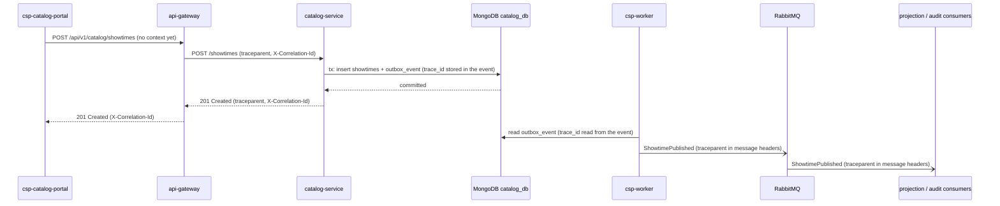

# CP1 - Critical journey and trace map

## Chosen journey

**Schedule and publish a showtime**: an administrator schedules a showtime in
`csp-catalog-portal`; Catalog stores it and the event `ShowtimePublished` reaches the billboard
projection and the audit consumers. It crosses five components and one asynchronous boundary
(MongoDB `outbox_event` -> `csp-worker` -> RabbitMQ).

Sources checked in `csp-docs`: `07-api/contracts/openapi/catalog-service.yaml` (`createShowtime`),
`09-microservices/services/03-catalog-service/{data-model,events}.md`, ADR-019 (outbox relay),
`09-microservices/services/01-api-gateway/README.md` (route `/api/v1/catalog/*` -> `:8082`).

## Hops

| # | Calls | Receives | Protocol | Operation | Sync/Async | Data |
|---|---|---|---|---|---|---|
| 1 | `csp-catalog-portal` | `api-gateway` | REST | `POST /api/v1/catalog/showtimes` | sync | none |
| 2 | `api-gateway` | `catalog-service` (`:8082`) | REST | `POST /showtimes` (`createShowtime`) | sync | none |
| 3 | `catalog-service` | MongoDB `catalog_db` | MongoDB driver | read `movies` and `rooms`; check overlap in `showtimes`; write `showtimes` + `outbox_event` in one transaction | sync | `showtimes`, `outbox_event` |
| 4 | `csp-worker` | MongoDB `catalog_db` | MongoDB driver | read `outbox_event` with role `catalog_outbox_reader` | async (polling) | `outbox_event` |
| 5 | `csp-worker` | RabbitMQ | AMQP | publish `ShowtimePublished`, routing key `cine.catalog.showtime-published.v1` | async | queue |
| 6 | billboard projection and audit consumers | RabbitMQ | AMQP | consume `ShowtimePublished` | async | none |

## Sequence diagram



## Trace context per hop

| Hop | Context that travels | Who creates or copies it |
|---|---|---|
| 1 | none: the portal is the browser origin | the gateway creates a new `trace_id` when no `traceparent` arrives |
| 2 | HTTP headers `traceparent` (W3C) and `X-Correlation-Id` (UUID, already read by `CorrelationIdFilter` in `csp-catalog-api`) | gateway |
| 3 | `trace_id` and `span_id` of the request span, written inside the `outbox_event` document | `catalog-service` (proposal: `data-model.md` has no such field today) |
| 4 | read back from `outbox_event` | `csp-worker` |
| 5 and 6 | AMQP message header `traceparent` | `csp-worker` publishes, consumers continue the trace |

`catalog-service` never talks to RabbitMQ (ADR-019), so the outbox document is the only carrier of the
trace across the asynchronous boundary.

## Span tree

```
POST /api/v1/catalog/showtimes            (api-gateway, root span)
  POST /showtimes                         (catalog-service, server span)
    mongodb find movies / rooms           (catalog-service -> catalog_db)
    mongodb find showtimes overlap        (catalog-service -> catalog_db)
    mongodb transaction showtimes+outbox  (catalog-service -> catalog_db)
  outbox.relay ShowtimePublished          (csp-worker, same trace_id, async boundary)
    mongodb find outbox_event             (csp-worker -> catalog_db)
    amqp publish showtime-published.v1    (csp-worker -> RabbitMQ)
      amqp consume showtime-published.v1  (projection consumer, same trace_id)
      amqp consume showtime-published.v1  (audit consumer, same trace_id)
```

The relay span starts after the HTTP response is sent, so it is a *follows-from* child of the request
span and keeps the same `trace_id`.
