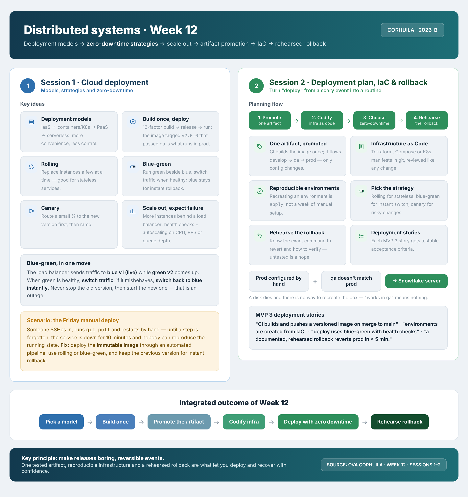

<!-- HU-STATUS TEMPLATE - do NOT remove the <!-- ... --> markers or the table headers.
     Your weekly grade is read AUTOMATICALLY from this file:
       12-week/hu-status/README.md  (inside YOUR fork). English. -->

# Weekly Status - Week 12

<!-- CONFIG-START - must match your profile repo (username/username) CONFIG -->
- FULL_NAME: Karen Johana Caicedo Arias
- GITHUB_USER: karencaicedo1907
- TEAM: CineSync Platform
- SPRINT_GOAL: Deliver the Catalog service stories HU-CATALOG-001 to HU-CATALOG-006 through `develop` and `qa`, make the catalog portal read the real API, prepare the 3.0.0 releases, and align the platform (MongoDB roles, composition, CI) with the norm.
<!-- CONFIG-END -->

## 1. User stories worked this week
| HU ID | Title | Status (todo/doing/done) | Evidence (PR or commit URL) |
|---|---|---|---|
| HU-CATALOG-001 | Admin Publishes a Movie | doing | In qa, release 3.0.0 open. https://github.com/code-corhuila/csp-catalog-api/pull/16, https://github.com/code-corhuila/csp-catalog-api/pull/23, https://github.com/code-corhuila/csp-catalog-db/pull/9, release https://github.com/code-corhuila/csp-catalog-api/pull/56 |
| HU-CATALOG-002 | Admin Defines a Room and Its Seat Layout | doing | In qa, release 3.0.0 open. https://github.com/code-corhuila/csp-catalog-api/pull/32, https://github.com/code-corhuila/csp-catalog-api/pull/60, https://github.com/code-corhuila/csp-catalog-db/pull/17 |
| HU-CATALOG-003 | Admin Schedules a Showtime | doing | In qa, release 3.0.0 open. https://github.com/code-corhuila/csp-catalog-api/pull/42, https://github.com/code-corhuila/csp-catalog-api/pull/64, https://github.com/code-corhuila/csp-catalog-db/pull/20 |
| HU-CATALOG-004 | Client Queries the Public Billboard | doing | In qa, release 3.0.0 open. https://github.com/code-corhuila/csp-catalog-api/pull/54, https://github.com/code-corhuila/csp-catalog-api/pull/65, https://github.com/code-corhuila/csp-catalog-db/pull/20 |
| HU-CATALOG-005 | Booking Validates Seats Against Catalog's Availability Contract | doing | In qa, release 3.0.0 open. https://github.com/code-corhuila/csp-catalog-api/pull/66, https://github.com/code-corhuila/csp-catalog-api/pull/67, https://github.com/code-corhuila/csp-catalog-api/pull/79, https://github.com/code-corhuila/csp-catalog-db/pull/21 |
| HU-CATALOG-006 | Client Searches Movies with Filters | doing | In qa, release 3.0.0 open. https://github.com/code-corhuila/csp-catalog-api/pull/75, https://github.com/code-corhuila/csp-catalog-api/pull/76, https://github.com/code-corhuila/csp-catalog-db/pull/24 |
| HU-FE-CATALOG-002 | Catalog Portal Reads the Real Catalog API | doing | In qa, release 3.0.0 open. https://github.com/code-corhuila/csp-catalog-portal/pull/74, https://github.com/code-corhuila/csp-catalog-portal/pull/77, https://github.com/code-corhuila/csp-api-gateway/pull/10, release https://github.com/code-corhuila/csp-catalog-portal/pull/78 |
| PLATFORM-MONGO-ROLES | Align the MongoDB roles, composition and CI of the catalog with the norm (Annex B and J) | doing | In qa, release 3.0.0 open. https://github.com/code-corhuila/csp-catalog-db/pull/27, https://github.com/code-corhuila/csp-infra-mongo/pull/10, https://github.com/code-corhuila/csp-infra-postgres/pull/26, release https://github.com/code-corhuila/csp-infra-mongo/pull/7 |

## 2. My individual contribution

### 2.1 Executive summary

Week 12  was the delivery week of the Catalog service. I opened **103 Pull Requests** (99 merged, 4 open) in 7 repositories of `code-corhuila`, and **64 issues** (61 closed): the technical issues of each task in the code repositories and the user stories in `csp-docs`. All the activity falls between 20 and 24 October (UTC).

The six stories **HU-CATALOG-001 to HU-CATALOG-006** were delivered layer by layer: one Pull Request per layer (domain, ports and use cases, MongoDB repository, routes) into `develop`, re-applied to `qa` with `git cherry-pick -x` and promoted by one more Pull Request per layer. The database side (`csp-catalog-db`) followed the same path, with validators and named indexes per collection. In `csp-catalog-portal` the portal now reads the real Catalog API (**HU-FE-CATALOG-002**), and `csp-api-gateway` routes the two public catalog reads. The specification went first in `csp-docs`: seven ADRs, the decisions DEC-004 to DEC-011 and the contract `catalog-service.yaml` up to version **1.9.0**.

Under the team's board rule (a story is Done only when it reaches `main`), every story is **doing**: all of them are promoted to `qa`, and the four release PRs of **3.0.0** are open and wait for the professor's approval. No `v3.0.0` tag exists yet. GitHub Actions of the organization is locked by billing since 2026-10-14, so each merge was justified in one comment per Pull Request and validated locally in Docker.

### 2.2 Week 12 matrix - consolidated state

| Repository | PRs opened by me | Merged | Open | Issues opened by me | State of the work |
|---|---|---|---|---|---|
| `csp-catalog-api` | **51** | 50 | 1 (#56) | 36 | HU-CATALOG-001 to 006 in `qa`; release 3.0.0 open |
| `csp-catalog-db` | **17** | 16 | 1 (#16) | 9 | 23 changesets, roles `catalog_outbox_reader` and `catalog_writer` in `qa`; release 3.0.0 open |
| `csp-docs` | **14** | 14 | 0 | 11 | ADRs, decisions, contract 1.9.0, delivery trails |
| `csp-catalog-portal` | **8** | 7 | 1 (#78) | 5 | HU-FE-CATALOG-002 in `qa`; release 3.0.0 open |
| `csp-infra-mongo` | **7** | 6 | 1 (#7) | 2 | catalog migrator, backup procedure, CI; release 3.0.0 open |
| `csp-infra-postgres` | **4** | 4 | 0 | 0 | catalog composed in the platform, in `qa` |
| `csp-api-gateway` | **2** | 2 | 0 | 1 | public catalog reads route, in `qa` |
| **Week 12 total** | **103** | **99** | **4** | **64** | — |

### 2.3 Pull Requests by story (all opened by `karencaicedo1907`, all merged unless noted)

| Story | Repository | Develop PRs | Promotion to qa |
|---|---|---|---|
| HU-CATALOG-001 (issue `csp-docs#189`) | `csp-catalog-api` | #6, #8, #10, #12, #14, #16 (movie aggregate, ports and idempotent use cases, MongoDB repository with transactional idempotency, error envelope and correlation filter, JWT authentication with `catalog:write`, movie routes validated against the contract) | #17 to #23 |
| | `csp-catalog-db` | #5, #7 (`movies` and `idempotency_key` collections with validators and named indexes) | #8, #9 |
| HU-CATALOG-002 (`csp-docs#190`) | `csp-catalog-api` | #26, #28, #30, #32 (room aggregate and seats, ports, repository, routes) | #57 to #60 |
| | `csp-catalog-db` | #11 | #17 |
| HU-CATALOG-003 (`csp-docs#191`) | `csp-catalog-api` | #36, #38, #40, #42 (time interval and overlap rule, room lock and transactional outbox event, routes) | #61 to #64 |
| | `csp-catalog-db` | #13 | #20 |
| HU-CATALOG-004 (`csp-docs#192`) | `csp-catalog-api` | #52, #53, #54 | #64, #65 |
| | `csp-catalog-db` | #15 | #20 |
| HU-CATALOG-005 (`csp-docs#193`) | `csp-catalog-api` | #55, #66 (availability use case and route for a service credential); #78 (additive `seatLayout` field agreed with Booking) | #67; #79 |
| | `csp-catalog-db` | #19 (role `catalog_outbox_reader`) | #21 |
| | `csp-docs` | #240 (contract 1.9.0) | — |
| HU-CATALOG-006 (`csp-docs#194`) | `csp-catalog-api` | #71, #73, #75 | #76 |
| | `csp-catalog-db` | #23 (search indexes) | #24 |
| | `csp-docs` | #225 | — |
| HU-FE-CATALOG-002 (`csp-docs#233`) | `csp-catalog-portal` | #71 to #74 (typed client, search state, billboard page and movie detail on the real API) | #75 to #77 |
| | `csp-api-gateway` | #9 (public catalog reads route) | #10 |
| | `csp-docs` | #234, #241 | — |

Release PRs (open, waiting for the professor's approval): `csp-catalog-api#56`, `csp-catalog-db#16`, `csp-catalog-portal#78`, `csp-infra-mongo#7`. I also added commits to `csp-api-gateway#6` and `csp-infra-postgres#15`, the 3.0.0 release PRs of those repositories, which belong to my teammate Oscar.

### 2.4 Documentation and decisions in `csp-docs` (specification first)

14 Pull Requests, all merged:

- ADR-037 movie states and idempotency key (#166), ADR-038 rooms (#173), ADR-039 showtimes and the `ShowtimePublished` event (#176), ADR-041 public billboard (#187), ADR-042 availability and the service credential (#188), ADR-044 movie search (#225), ADR-049 MongoDB roles of the catalog (#253).
- Decisions DEC-004 to DEC-011 of the catalog service and the contract `catalog-service.yaml` up to version 1.9.0 (#171, #240).
- Erratum on the outbox reader role (#219), delivery trails of the stories (#232, #241) and technical debt items TD-042 to TD-044 (#253, #254).

### 2.5 Platform and infrastructure work

- **MongoDB roles aligned with Annex B and J of the norm:** `catalog_migrator` owns the database and `catalog_app` starts with no role and receives `catalog_writer`. Pull Requests: `csp-catalog-db` #26/#27, `csp-infra-mongo` #9/#10, `csp-infra-postgres` #23/#24.
- **Catalog composed in the platform:** `csp-infra-postgres` #25/#26 and `csp-catalog-api` #82/#83.
- **MongoDB instance:** changelog, backup and restore procedure rehearsed on a disposable instance, and a README that describes only what exists (`csp-infra-mongo` #4 to #6).
- **README of the API:** `csp-catalog-api` #80.
- **CI:** tests with a MongoDB with authentication and the real logins, and fixed versions of the migration executor (`csp-catalog-api#90`, `csp-catalog-db#29`, `csp-infra-mongo#12`).
- **Development seed script:** added (`csp-catalog-api` #85/#86) and removed again (#87/#88), because the team works with real data, not synthetic data.

### 2.6 Quality

- `csp-catalog-api`: **220** tests in `catalog-core`, **273** in `catalog-adapters` and **61** in `catalog-app` all pass, with integration and contract tests included, against a MongoDB replica set and the official contract.
- `csp-catalog-db`: the rebuild cycle applies **23** changesets, applies **0** the second time, rolls back and re-applies, and passes its schema and role tests.
- `csp-catalog-portal`: **145** specs pass. `csp-api-gateway`: **56** smoke checks pass.
- These results were obtained locally in Docker, not in GitHub Actions (see section 3).

### 2.7 User stories and issues - state at the end of the week

| Story / Issue | Repository | State | Evidence |
|---|---|---|---|
| HU-CATALOG-001 to 004 (issues #189 to #192) | `csp-docs` | **doing** - in `qa`; story issues closed | delivery trail PR `csp-docs#232` |
| HU-CATALOG-005, HU-CATALOG-006 (issues #193, #194) | `csp-docs` | **doing** - in `qa`; story issues still open | delivery trail PR `csp-docs#232` |
| HU-FE-CATALOG-002 (issue #233) | `csp-docs` | **doing** - in `qa`; story issue still open | delivery trail PR `csp-docs#241` |
| Release 3.0.0 | four repositories | **open**, no tag `v3.0.0` | `csp-catalog-api#56`, `csp-catalog-db#16`, `csp-catalog-portal#78`, `csp-infra-mongo#7` |

Of the 64 issues I opened, 61 are closed and 3 are open (the three story issues above).

## 3. Blockers and risks

- **GitHub Actions is locked by billing** since 2026-10-14: no workflow runs, so every merge was justified in one comment per Pull Request and validated locally in Docker; the review bot does not review during the lock.
- **The releases wait for the professor's approval**, and the tags `v3.0.0` do not exist yet. Until they reach `main`, no story can be Done under the board rule.
- **There is no real way yet for an administrator to load catalog data** (technical debt **TD-044**): the gateway routes only the two public reads and the portal administration view still reads a synthetic dataset. Booking cannot try its seat map against real showtimes.
- **The Concessions login is missing in the platform composition**; it has to be agreed with my teammates Nicolás and Yeferson.
- **The relay of the catalog outbox in `csp-worker` is not implemented**, so `ShowtimePublished` events are written to the outbox but not published.
- **`/health` and `/health/ready` are declared in the contract but not served** (404).

## 4. Plan for next week

- Get the 3.0.0 releases approved and merged in order (`csp-infra-mongo` first), create the `v3.0.0` tags and close the story issues.
- Carry the CI changes to `qa` and into the releases.
- Define with the Product Owner the story that lets an administrator load the catalog (TD-044).
- Agree the Concessions login in the platform composition with Nicolás and Yeferson.
- Serve the health routes `/health` and `/health/ready`.
- Implement the relay of the catalog outbox in `csp-worker`.

## 5. Compliance self-check
- [x] Conventional Commits - `type(scope): summary`
- [x] Per-environment HU branch + PR to that environment (hu-xxx-dev -> develop, ...)
- [x] Testable acceptance criteria
- [x] Tests added/updated (unit / integration)
- [x] DDD / hexagonal boundaries respected (domain has no I/O)
- [x] No secrets; config via environment variables

Notes: branches and Pull Requests follow the project Git-Flow: `feat/` or `chore/` to `develop`, `qa-promote/` to `qa`, `release/3.0.0` to `main`. `catalog-core` has no framework imports. The passwords in CI are throwaways of disposable containers.

## 6. Evidence links

- Search of my Pull Requests in the window: https://github.com/search?q=org%3Acode-corhuila+author%3Akarencaicedo1907+is%3Apr+created%3A%3E%3D2026-10-18&type=pullrequests
- Release PRs (open): https://github.com/code-corhuila/csp-catalog-api/pull/56, https://github.com/code-corhuila/csp-catalog-db/pull/16, https://github.com/code-corhuila/csp-catalog-portal/pull/78, https://github.com/code-corhuila/csp-infra-mongo/pull/7
- Teammate release PRs where I added commits: https://github.com/code-corhuila/csp-api-gateway/pull/6, https://github.com/code-corhuila/csp-infra-postgres/pull/15
- Story issues: https://github.com/code-corhuila/csp-docs/issues/189, https://github.com/code-corhuila/csp-docs/issues/190, https://github.com/code-corhuila/csp-docs/issues/191, https://github.com/code-corhuila/csp-docs/issues/192, https://github.com/code-corhuila/csp-docs/issues/193, https://github.com/code-corhuila/csp-docs/issues/194, https://github.com/code-corhuila/csp-docs/issues/233
- Delivery trails and decisions: https://github.com/code-corhuila/csp-docs/pull/232, https://github.com/code-corhuila/csp-docs/pull/241, https://github.com/code-corhuila/csp-docs/pull/253, https://github.com/code-corhuila/csp-docs/pull/254
- Contract 1.9.0 (seat layout): https://github.com/code-corhuila/csp-docs/pull/240
- Platform: https://github.com/code-corhuila/csp-catalog-db/pull/27, https://github.com/code-corhuila/csp-infra-mongo/pull/10, https://github.com/code-corhuila/csp-infra-postgres/pull/26, https://github.com/code-corhuila/csp-catalog-api/pull/83

### Week 12 work summary

Week 12 (October 18-24, 2026) was the delivery week of the Catalog service. All my activity took place between October 20 and 24: **103 Pull Requests** (99 merged, 4 open) in 7 repositories and **64 issues** (61 closed).

The stories HU-CATALOG-001 to HU-CATALOG-006 and HU-FE-CATALOG-002 were delivered through `develop` and promoted to `qa`, one Pull Request per layer, with `git cherry-pick -x` traceability. The Catalog API suite passes with 220 + 273 + 61 tests, the database rebuild cycle applies 23 changesets, the portal passes 145 specs and the gateway 56 smoke checks. The MongoDB roles were aligned with the norm and the Catalog was composed in the platform.

The four release PRs of 3.0.0 are open and wait for the professor's approval, so the stories stay **doing** until they reach `main` and the `v3.0.0` tags are created. GitHub Actions has been locked by billing since October 14, so the merges were validated locally in Docker.

### Week 12 summary session 1-2:

