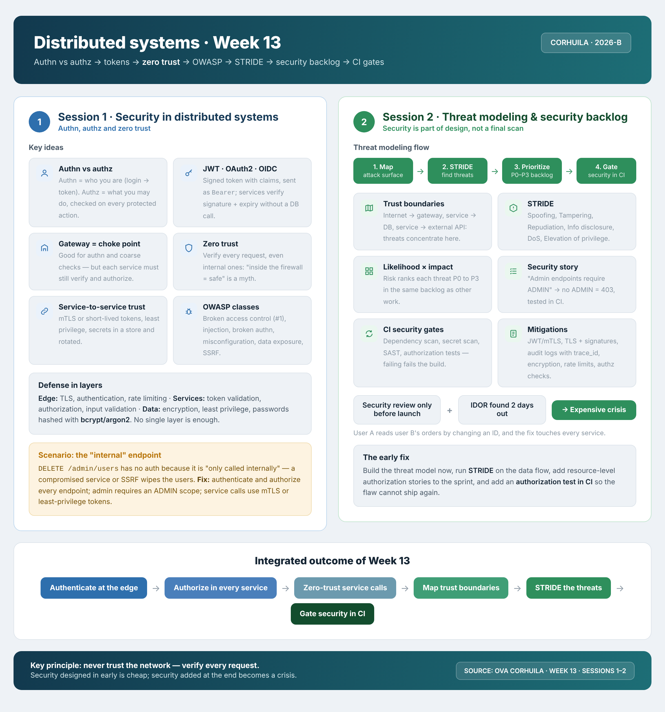

<!-- HU-STATUS TEMPLATE - do NOT remove the <!-- ... --> markers or the table headers.
     Your weekly grade is read AUTOMATICALLY from this file:
       13-week/hu-status/README.md  (inside YOUR fork). English. -->

# Weekly Status - Week 13

<!-- CONFIG-START - must match your profile repo (username/username) CONFIG -->
- FULL_NAME: Karen Johana Caicedo Arias
- GITHUB_USER: karencaicedo1907
- TEAM: CineSync Platform
- SPRINT_GOAL: Threat-model the trust boundary booking-service to catalog-service (showtime availability) and turn it into three security stories and CI gates.
<!-- CONFIG-END -->

## 1. User stories worked this week
| HU ID | Title | Status (todo/doing/done) | Evidence (PR or commit URL) |
|---|---|---|---|
| W13-STRIDE | STRIDE analysis of booking-service to catalog-service | doing | PR https://github.com/code-corhuila/csp-docs/pull/286 (open, reviewed by a teammate, commit 705cd9b answers the review) |
| csp-docs#287 | [security] Reject service tokens that are not issued for catalog-service | todo | https://github.com/code-corhuila/csp-docs/issues/287 |
| csp-docs#288 | [security] Audit every rejected call to the availability route | todo | https://github.com/code-corhuila/csp-docs/issues/288 |
| csp-docs#289 | [security] Booking verifies the seat layout it receives from catalog | todo | https://github.com/code-corhuila/csp-docs/issues/289 |
| csp-catalog-api#95 | Serve the health and readiness routes of the contract | done | https://github.com/code-corhuila/csp-docs/pull/273, https://github.com/code-corhuila/csp-catalog-api/pull/96, https://github.com/code-corhuila/csp-catalog-api/pull/97 (promoted to qa; issue https://github.com/code-corhuila/csp-catalog-api/issues/95) |
| csp-catalog-api#98 | Container healthcheck of the catalog service | done | https://github.com/code-corhuila/csp-catalog-api/pull/99, https://github.com/code-corhuila/csp-catalog-api/pull/100 (promoted to qa; issue https://github.com/code-corhuila/csp-catalog-api/issues/98) |
| csp-catalog-portal#64 | Container healthcheck of the portal resolves localhost to ::1 | done | https://github.com/code-corhuila/csp-catalog-portal/pull/79 (issue https://github.com/code-corhuila/csp-catalog-portal/issues/64) |
| csp-docs#288 (implementation) | Audit every rejected call to the availability route | doing | https://github.com/code-corhuila/csp-catalog-api/pull/101 (merged; story https://github.com/code-corhuila/csp-docs/issues/288) |

## 2. My individual contribution
- Claimed the boundary in https://github.com/code-corhuila/csp-docs/issues/276 and mapped the attack surface in `13-week/workshop/01-attack-surface.md`.
- Wrote the STRIDE table (six rows, ranking and residual risk) in PR #286 and opened the three security issues with labels and priority.
- Proposed `security.yml` (gitleaks, OWASP dependency-check, negative authorization test) in `13-week/workshop/04-security-ci/`.
- Reviewed row S of a teammate: https://github.com/code-corhuila/csp-docs/pull/277#pullrequestreview-5691804173
- Answered the review of my PR: changed rows S and D and the residual risk (https://github.com/code-corhuila/csp-docs/pull/286#issuecomment-6506055358).
- Refined the three issues (#287 now names its dependency on csp-auth) and ran the negative test: the baseline passes and the test of story #287 fails with `expected: <401> but was: <200>`, which confirms that the service does not require `aud`. Output in `13-week/workshop/04-security-ci/HOW-TO-RUN.md`; `security.yml` was checked with actionlint (no error).

- The implementation plan for my project is in the final section of the reflection document.

### Catalog service and portal
- Health and readiness routes of the contract: documented, implemented and promoted to qa: https://github.com/code-corhuila/csp-docs/pull/273, https://github.com/code-corhuila/csp-catalog-api/pull/96, https://github.com/code-corhuila/csp-catalog-api/pull/97 (technical issue https://github.com/code-corhuila/csp-catalog-api/issues/95).
- Container healthcheck of the catalog service, in develop and promoted to qa: https://github.com/code-corhuila/csp-catalog-api/pull/99, https://github.com/code-corhuila/csp-catalog-api/pull/100 (technical issue https://github.com/code-corhuila/csp-catalog-api/issues/98).
- Security audit (story https://github.com/code-corhuila/csp-docs/issues/288): every call rejected on the availability route is logged with sub, source, method, route, result and traceId, never the token; checked against the log of the real service: https://github.com/code-corhuila/csp-catalog-api/pull/101
- Container healthcheck of the catalog portal now uses 127.0.0.1: localhost resolved to ::1 while nginx listens on IPv4 only, so the container showed unhealthy while serving traffic. Verified in Docker before and after, 145 unit tests: https://github.com/code-corhuila/csp-catalog-portal/pull/79 (issue https://github.com/code-corhuila/csp-catalog-portal/issues/64)

### Security and threat model
- STRIDE threat model Booking to Catalog (showtime availability), written and answered after the peer review; still open: https://github.com/code-corhuila/csp-docs/pull/286
- Stories derived from it: https://github.com/code-corhuila/csp-docs/issues/287 and https://github.com/code-corhuila/csp-docs/issues/288
- Peer review of the Gateway to Booking threat model: https://github.com/code-corhuila/csp-docs/pull/277

### Integration with Booking
- Story https://github.com/code-corhuila/csp-docs/issues/289 reassigned to the Booking owner, with a comment that separates what belongs to Booking from what depends on a TLS ADR.
- End-to-end check Booking to Catalog on the platform composition in Docker: 21 checks passed, 0 failed on develop; repeated on the Booking pull request, 22 of 23, and the one failure was an assumption of the check script. Local evidence, not published as a PR.
- Review of the Booking pull request that validates the seats against the Catalog layout: https://github.com/code-corhuila/csp-booking-api/pull/71

### Release and board
- The 17 Catalog cards that were In Review were moved to Done because they are in the open 3.0.0 release pull requests: https://github.com/orgs/code-corhuila/projects/18
- Release 3.0.0 pull requests of my domain, waiting for approval: https://github.com/code-corhuila/csp-catalog-api/pull/56, https://github.com/code-corhuila/csp-catalog-portal/pull/78, https://github.com/code-corhuila/csp-infra-mongo/pull/7

## 3. Blockers and risks
- The negative test of story #287 fails today on purpose until the story is implemented, and it depends on csp-auth issuing `iss` and `aud` first.
- `security.yml` was validated but never ran on GitHub Actions.
- The library book is cited, but its pages and the `[B]` rows are still missing.

## 4. Plan for next week

- Start story #287 with the change of the service credential contract (ADR) with the csp-auth owner.

## 5. Compliance self-check
- [x] Conventional Commits - `type(scope): summary`
- [ ] Per-environment HU branch + PR to that environment (hu-xxx-dev -> develop, ...)
- [x] Testable acceptance criteria
- [x] Tests added/updated (unit / integration)
- [x] DDD / hexagonal boundaries respected (domain has no I/O)
- [x] No secrets; config via environment variables

## 6. Evidence links
- Workshop folder: https://github.com/karencaicedo1907/sistemas-distribuidos-2026-b-g1/tree/main/13-week/workshop
- Claim issue: https://github.com/code-corhuila/csp-docs/issues/276
- Commits: CP6 https://github.com/code-corhuila/csp-docs/commit/705cd9b, CP7 https://github.com/karencaicedo1907/sistemas-distribuidos-2026-b-g1/commit/4098432, CP8 https://github.com/karencaicedo1907/sistemas-distribuidos-2026-b-g1/commit/7341191
- Reflection document: https://docs.google.com/document/d/1vamzHa7fk9dxduzl3-g55HQ4cscvzR68_6XMvWDedxg/edit?usp=sharing
- Catalog service: https://github.com/code-corhuila/csp-docs/pull/273, https://github.com/code-corhuila/csp-catalog-api/pull/96, https://github.com/code-corhuila/csp-catalog-api/pull/97, https://github.com/code-corhuila/csp-catalog-api/pull/99, https://github.com/code-corhuila/csp-catalog-api/pull/100, https://github.com/code-corhuila/csp-catalog-api/pull/101
- Catalog portal: https://github.com/code-corhuila/csp-catalog-portal/pull/79
- Threat models and reviews: https://github.com/code-corhuila/csp-docs/pull/286, https://github.com/code-corhuila/csp-docs/pull/277, https://github.com/code-corhuila/csp-booking-api/pull/71
- Board: https://github.com/orgs/code-corhuila/projects/18

### Week 13 summary session 1-2:

