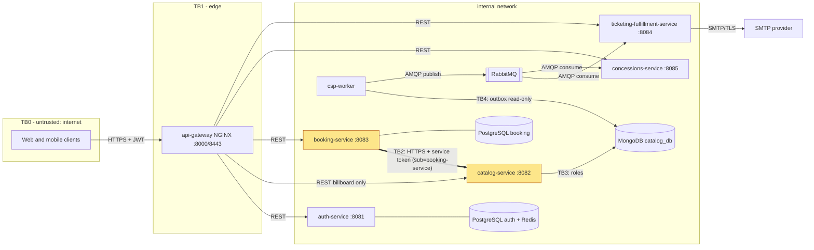

# CP1 - Attack surface map

Boundary I own: **booking-service to catalog-service**, route `GET /api/v1/catalog/showtimes/{showtimeId}/availability` (claim issue: https://github.com/code-corhuila/csp-docs/issues/276).

## Data flow and trust boundaries

Trust boundaries: TB0/TB1 internet to api-gateway, TB2 booking-service to catalog-service (**mine**, highlighted), TB3 catalog-service to MongoDB `catalog_db`, TB4 csp-worker to the catalog outbox and RabbitMQ.

## Asset inventory

| Asset | Where it lives | Classification |
|---|---|---|
| Service token with `sub=booking-service` | Issued by auth-service, sent by booking-service to catalog-service | Restricted |
| Public key of auth-service (JWKS, RS256) | auth-service `/auth/jwks`, configured in catalog-api | Internal |
| Seat layout (`seatLayout`: label, row, number, type) | MongoDB `catalog_db`, answered by availability | Internal |
| Showtime data (`movieTitle`, `roomName`, `startsAt`) | MongoDB `catalog_db` | Internal |
| `SERVICE_SUBJECTS` list of allowed callers | Environment of catalog-api (`.env.example`) | Confidential |
| User identity and email | auth-service PostgreSQL schema `auth` | Confidential |

## Entry points of my boundary

| Entry point | Who calls it | How it authenticates today |
|---|---|---|
| `GET /api/v1/catalog/showtimes/{showtimeId}/availability` on catalog-service :8082 | booking-service, directly (the gateway does not route it, `csp-api-gateway/nginx/routes/catalog.conf`) | Bearer JWT RS256 verified by `JwtAuthenticationFilter`; `sub` must be in `SERVICE_SUBJECTS` (default `booking-service`, ADR-042); no token is 401, a user token is 403 |
| `GET /health` and `GET /health/ready` on catalog-service | Platform and probes | None (public by contract) |
