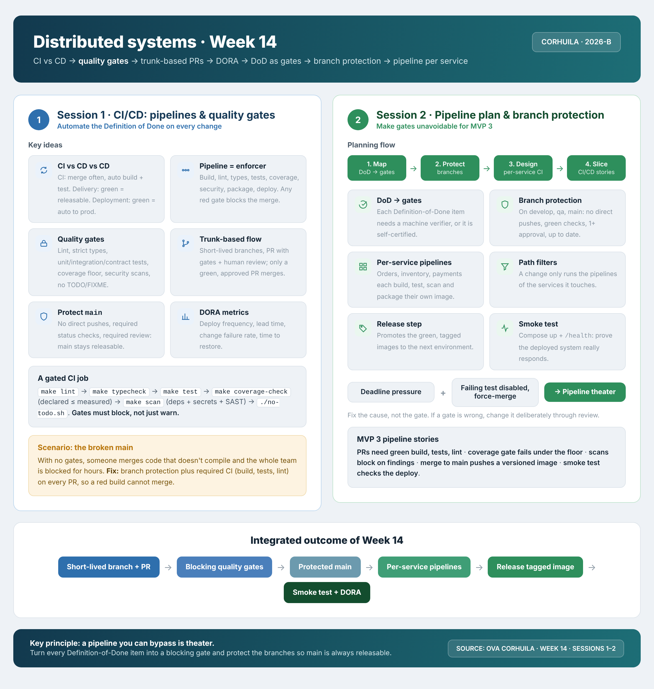

<!-- HU-STATUS TEMPLATE - do NOT remove the <!-- ... --> markers or the table headers.
     Your weekly grade is read AUTOMATICALLY from this file:
       14-week/hu-status/README.md  (inside YOUR fork). English. -->

# Weekly Status - Week 14

<!-- CONFIG-START - must match your profile repo (username/username) CONFIG -->
- FULL_NAME: Karen Johana Caicedo Arias
- GITHUB_USER: karencaicedo1907
- TEAM: CineSync Platform
- SPRINT_GOAL: Connect the catalog administration screens to the real catalog API, harden the Booking to Catalog boundary (service credential and https), and deliver the Concessions administration, snack selection and workflow operations up to `qa` and the open 3.0.0 releases.
<!-- CONFIG-END -->

## 1. User stories worked this week
| HU ID | Title | Status (todo/doing/done) | Evidence (PR or commit URL) |
|---|---|---|---|
| HU-FE-CATALOG-002 | Catalog portal administration screens (movies, rooms, showtimes, billboard) on the real catalog API | doing | In qa, release 3.0.0 open. https://github.com/code-corhuila/csp-catalog-portal/pull/83, https://github.com/code-corhuila/csp-catalog-portal/pull/84, https://github.com/code-corhuila/csp-catalog-portal/pull/85, https://github.com/code-corhuila/csp-catalog-portal/pull/86, https://github.com/code-corhuila/csp-catalog-portal/pull/87, promoted by https://github.com/code-corhuila/csp-catalog-portal/pull/90 to https://github.com/code-corhuila/csp-catalog-portal/pull/94 |
| csp-docs#287 | [security] Reject service tokens that are not issued for catalog-service (`iss` and `aud`) | doing | In qa, release 3.0.0 open. https://github.com/code-corhuila/csp-catalog-api/pull/103, promoted by https://github.com/code-corhuila/csp-catalog-api/pull/106 |
| ADR-067 | Serve the catalog service only over https with the certificate of the platform | doing | In qa, release 3.0.0 open. https://github.com/code-corhuila/csp-docs/pull/336, https://github.com/code-corhuila/csp-catalog-api/pull/104, https://github.com/code-corhuila/csp-catalog-api/pull/105, TLS mounts fixed by https://github.com/code-corhuila/csp-catalog-api/pull/108 and https://github.com/code-corhuila/csp-catalog-api/pull/109 |
| HU-CONCESSIONS-001 to 003 | Admin products, combos and stock on the Concessions portal (co-owned) | doing | In qa, release 3.0.0 open. https://github.com/code-corhuila/csp-concessions-portal/pull/51, https://github.com/code-corhuila/csp-concessions-portal/pull/57, https://github.com/code-corhuila/csp-concessions-portal/pull/58, promoted by https://github.com/code-corhuila/csp-concessions-portal/pull/52 and https://github.com/code-corhuila/csp-concessions-portal/pull/59 |
| HU-CONCESSIONS-004 | Client Orders Concessions: snack selection and order submission (co-owned) | doing | In qa, release 3.0.0 open. https://github.com/code-corhuila/csp-concessions-portal/pull/53, https://github.com/code-corhuila/csp-concessions-portal/pull/54, https://github.com/code-corhuila/csp-concessions-portal/pull/55, release https://github.com/code-corhuila/csp-concessions-portal/pull/56 |
| HU-CONCESSIONS-006 | Admin Manages Product Status Lifecycle: tests, gateway route and docs (co-owned) | doing | In qa, release 3.0.0 open. https://github.com/code-corhuila/csp-concessions-api/pull/46, https://github.com/code-corhuila/csp-concessions-api/pull/47, https://github.com/code-corhuila/csp-api-gateway/pull/32, https://github.com/code-corhuila/csp-api-gateway/pull/33, https://github.com/code-corhuila/csp-docs/pull/328 |
| PLATFORM-WORKFLOW | Concessions workflow operations, platform composition and the outbox reader grant of the worker | doing | In qa or in the release. https://github.com/code-corhuila/csp-concessions-api/pull/51, https://github.com/code-corhuila/csp-concessions-api/pull/54, https://github.com/code-corhuila/csp-infra-postgres/pull/71, https://github.com/code-corhuila/csp-infra-postgres/pull/73, https://github.com/code-corhuila/csp-ticketing-db/pull/24, https://github.com/code-corhuila/csp-ticketing-db/pull/26 |
| HU-BOOKING-ADMIN | Admin view of all reservations in the Booking portal and its gateway route | doing | In qa or in the release. https://github.com/code-corhuila/csp-booking-portal/pull/93, https://github.com/code-corhuila/csp-booking-portal/pull/95, https://github.com/code-corhuila/csp-api-gateway/pull/43, https://github.com/code-corhuila/csp-api-gateway/pull/45 |

## 2. My individual contribution

### 2.1 Executive summary

This week I opened **81 Pull Requests** in 10 repositories of `code-corhuila`: **80 merged and 1 open** (the release 3.0.0 of the Concessions portal, `csp-concessions-portal#56`). The figures come from GitHub, searching the Pull Requests I created from 2026-11-01 to 2026-11-08 (UTC). Under the team's board rule a story is Done only when it reaches `main`, so every story below stays **doing**: all the work is promoted to `qa` or added to the release pull requests, which wait for approval.

| Repository | PRs opened by me | Main work |
|---|---|---|
| `csp-catalog-portal` | 18 | administration screens on the real catalog API |
| `csp-concessions-portal` | 17 | products, combos, inventory, snack selection, deploy hardening |
| `csp-docs` | 11 | ADRs, decisions and traceability |
| `csp-api-gateway` | 7 | catalog administration, concessions and admin reservations routes |
| `csp-concessions-api` | 7 | workflow operations and service tokens |
| `csp-catalog-api` | 6 | service credential and https only |
| `csp-worker` | 4 | relay data sources and migrator retry |
| `csp-booking-portal` | 3 | admin view of all reservations |
| `csp-ticketing-db` | 3 | outbox reader role for the worker |
| `csp-infra-postgres` | 3 | concessions in the platform |
| `csp-concessions-db` | 2 | migration executor retry |
| **Total** | **81** | 80 merged, 1 open |

### 2.2 Catalog (my domain)

- **`csp-catalog-portal` (18 PRs):** the administration screens of movies, rooms, showtime state and billboard are connected to the real catalog API through a typed service ([#83](https://github.com/code-corhuila/csp-catalog-portal/pull/83), [#84](https://github.com/code-corhuila/csp-catalog-portal/pull/84), [#85](https://github.com/code-corhuila/csp-catalog-portal/pull/85), [#86](https://github.com/code-corhuila/csp-catalog-portal/pull/86), [#87](https://github.com/code-corhuila/csp-catalog-portal/pull/87)). I removed the synthetic seat map that nothing links to ([#95](https://github.com/code-corhuila/csp-catalog-portal/pull/95), [#96](https://github.com/code-corhuila/csp-catalog-portal/pull/96)), fixed the room overlap alert so it clears when the form or the billboard changes ([#88](https://github.com/code-corhuila/csp-catalog-portal/pull/88)), documented why only the federation assets send the CORS header ([#81](https://github.com/code-corhuila/csp-catalog-portal/pull/81)), saved `tsconfig.federation.json` without a byte order mark ([#80](https://github.com/code-corhuila/csp-catalog-portal/pull/80)) and documented the `qa-promote` prefix in the branching diagram ([#97](https://github.com/code-corhuila/csp-catalog-portal/pull/97), [#98](https://github.com/code-corhuila/csp-catalog-portal/pull/98)). Everything is promoted to `qa` ([#89](https://github.com/code-corhuila/csp-catalog-portal/pull/89) to [#94](https://github.com/code-corhuila/csp-catalog-portal/pull/94)).
- **`csp-catalog-api` (6 PRs):**
  - the availability route requires `iss` and `aud` in the service credential ([#103](https://github.com/code-corhuila/csp-catalog-api/pull/103), story csp-docs#287);
  - the service is served only over https with the certificate of the platform ([#104](https://github.com/code-corhuila/csp-catalog-api/pull/104), [#105](https://github.com/code-corhuila/csp-catalog-api/pull/105), ADR-067);
  - promotion to `qa` of the credential and its audit ([#106](https://github.com/code-corhuila/csp-catalog-api/pull/106));
  - fix of the TLS mounts of the compose file ([#108](https://github.com/code-corhuila/csp-catalog-api/pull/108), [#109](https://github.com/code-corhuila/csp-catalog-api/pull/109)).
- **`csp-api-gateway` (7 PRs):** routes of the catalog administration ([#27](https://github.com/code-corhuila/csp-api-gateway/pull/27), [#28](https://github.com/code-corhuila/csp-api-gateway/pull/28)), of the concessions service ([#32](https://github.com/code-corhuila/csp-api-gateway/pull/32), [#33](https://github.com/code-corhuila/csp-api-gateway/pull/33)) and `/admin/reservations` ([#43](https://github.com/code-corhuila/csp-api-gateway/pull/43), [#44](https://github.com/code-corhuila/csp-api-gateway/pull/44), [#45](https://github.com/code-corhuila/csp-api-gateway/pull/45)), each promoted to `qa` or added to the release.

### 2.3 Concessions (co-owned)

- **`csp-concessions-portal` (17 PRs):** lifecycle of products ([#51](https://github.com/code-corhuila/csp-concessions-portal/pull/51), [#52](https://github.com/code-corhuila/csp-concessions-portal/pull/52)), combos ([#57](https://github.com/code-corhuila/csp-concessions-portal/pull/57)), inventory and stock movements ([#58](https://github.com/code-corhuila/csp-concessions-portal/pull/58), [#59](https://github.com/code-corhuila/csp-concessions-portal/pull/59)), snack selection and order submission to the API ([#53](https://github.com/code-corhuila/csp-concessions-portal/pull/53), [#54](https://github.com/code-corhuila/csp-concessions-portal/pull/54), [#55](https://github.com/code-corhuila/csp-concessions-portal/pull/55)). Deploy hardening: healthcheck on 127.0.0.1 ([#60](https://github.com/code-corhuila/csp-concessions-portal/pull/60), [#61](https://github.com/code-corhuila/csp-concessions-portal/pull/61)), anchored CORS regex ([#62](https://github.com/code-corhuila/csp-concessions-portal/pull/62), [#64](https://github.com/code-corhuila/csp-concessions-portal/pull/64)) and security headers kept on the health endpoint ([#66](https://github.com/code-corhuila/csp-concessions-portal/pull/66), [#67](https://github.com/code-corhuila/csp-concessions-portal/pull/67)); README with the `qa-promote` prefix ([#63](https://github.com/code-corhuila/csp-concessions-portal/pull/63), [#65](https://github.com/code-corhuila/csp-concessions-portal/pull/65)). [#56](https://github.com/code-corhuila/csp-concessions-portal/pull/56) is the release 3.0.0 of the portal and is **open**.
- **`csp-concessions-api` (7 PRs):** tests of HU-CONCESSIONS-006 ([#46](https://github.com/code-corhuila/csp-concessions-api/pull/46), [#47](https://github.com/code-corhuila/csp-concessions-api/pull/47)), internal operations of the workflow to place and cancel an order ([#51](https://github.com/code-corhuila/csp-concessions-api/pull/51), [#54](https://github.com/code-corhuila/csp-concessions-api/pull/54)), 30 s clock skew tolerance of the token ([#48](https://github.com/code-corhuila/csp-concessions-api/pull/48)), subject lists of the service tokens ([#52](https://github.com/code-corhuila/csp-concessions-api/pull/52)) and reading of the database login ([#53](https://github.com/code-corhuila/csp-concessions-api/pull/53)).
- **`csp-concessions-db` (2 PRs):** connection retry of the migration executor while the instance starts ([#14](https://github.com/code-corhuila/csp-concessions-db/pull/14), [#15](https://github.com/code-corhuila/csp-concessions-db/pull/15)).

### 2.4 Cross-cutting work and end-to-end test

- **`csp-infra-postgres` (3 PRs):** Concessions composed in the platform and its variables in the `.env.example` files ([#71](https://github.com/code-corhuila/csp-infra-postgres/pull/71), [#72](https://github.com/code-corhuila/csp-infra-postgres/pull/72), [#73](https://github.com/code-corhuila/csp-infra-postgres/pull/73)).
- **`csp-worker` (4 PRs):** compilation with parameters so each relay binds its own data source ([#76](https://github.com/code-corhuila/csp-worker/pull/76), [#77](https://github.com/code-corhuila/csp-worker/pull/77)) and retry of the migration executor ([#78](https://github.com/code-corhuila/csp-worker/pull/78), [#79](https://github.com/code-corhuila/csp-worker/pull/79)).
- **`csp-ticketing-db` (3 PRs):** migration V013 gives the worker the outbox reader role ([#24](https://github.com/code-corhuila/csp-ticketing-db/pull/24), [#25](https://github.com/code-corhuila/csp-ticketing-db/pull/25), [#26](https://github.com/code-corhuila/csp-ticketing-db/pull/26)). Without it the `TicketIssued` events were never published.
- **`csp-booking-portal` (3 PRs):** the admin view "All reservations" ([#93](https://github.com/code-corhuila/csp-booking-portal/pull/93), [#94](https://github.com/code-corhuila/csp-booking-portal/pull/94), [#95](https://github.com/code-corhuila/csp-booking-portal/pull/95)).
- **Environments (not Pull Requests):** Docker stacks for dev, qa and release, the script `probar-flujo.sh` (45 checks, all pass) and desktop shortcuts.

### 2.5 Documentation (`csp-docs`, 11 PRs)

- **ADRs:** ADR-067 (TLS between booking and catalog, [#336](https://github.com/code-corhuila/csp-docs/pull/336), aligned in [#354](https://github.com/code-corhuila/csp-docs/pull/354)), ADR-069 (workflow operations of Concessions with contract 2.6.0, [#357](https://github.com/code-corhuila/csp-docs/pull/357), [#359](https://github.com/code-corhuila/csp-docs/pull/359)) and ADR-019 (paged relay discovery, [#361](https://github.com/code-corhuila/csp-docs/pull/361)).
- **Decisions:** dec-013 and dec-014 of the catalog with the amendment of dec-008 by ADR-056 ([#318](https://github.com/code-corhuila/csp-docs/pull/318)), the administration screens covered by a technical task ([#316](https://github.com/code-corhuila/csp-docs/pull/316)) and the record that the catalog relay is not written until a consumer exists ([#362](https://github.com/code-corhuila/csp-docs/pull/362)).
- **Traceability:** HU-CONCESSIONS-006 marked as done in `qa` ([#328](https://github.com/code-corhuila/csp-docs/pull/328)), the reservation id that Booking passes to the snack selection ([#329](https://github.com/code-corhuila/csp-docs/pull/329)) and the administration screens recorded in the trails of the stories ([#338](https://github.com/code-corhuila/csp-docs/pull/338)).
- **Threat model:** the STRIDE booking to catalog ([csp-docs#286](https://github.com/code-corhuila/csp-docs/pull/286)) was merged after this week's range, so it is not counted in the figures above.

## 3. Blockers and risks
- The 3.0.0 releases (`csp-concessions-portal#56` and the release pull requests of my domain) wait for approval, so no story can be Done under the board rule yet.
- GitHub Actions of the organization is locked by billing, so no CI ran on these pull requests. Each change was validated locally (Docker stacks, unit and integration tests, and the end-to-end check `probar-flujo.sh`) and the result is declared in the pull request.
- The Catalog relay of the outbox is not written because no service consumes `ShowtimePublished` yet (recorded in csp-docs#362); it will be written when a consumer is approved.
- Co-owned Concessions work depends on agreements with my teammates (service token subjects, workflow operations).

## 4. Plan for next week
- Get the open release pull requests approved and merged, create the tags and move the stories to Done.
- Keep the end-to-end check `probar-flujo.sh` passing after each promotion.
- Close the pending traceability of the administration screens in the stories of the catalog.
- When GitHub Actions runs again, rerun the workflows of the pull requests that were merged without checks.

## 5. Compliance self-check
- [x] Conventional Commits - `type(scope): summary`
- [x] One branch per task from `develop` with the HU in its name (`feat/`, `fix/`, `chore/`), PR to `develop`, then promotion to `qa` by `qa-promote/` branches (ADR-021)
- [x] Testable acceptance criteria
- [x] Tests added/updated (unit / integration)
- [x] DDD / hexagonal boundaries respected (domain has no I/O)
- [x] No secrets; config via environment variables

## 6. Evidence links
- Search of my Pull Requests of the week: https://github.com/search?q=org%3Acode-corhuila+author%3Akarencaicedo1907+is%3Apr+created%3A2026-11-01..2026-11-08&type=pullrequests
- Catalog portal: https://github.com/code-corhuila/csp-catalog-portal/pulls?q=is%3Apr+author%3Akarencaicedo1907
- Catalog API: https://github.com/code-corhuila/csp-catalog-api/pull/103, https://github.com/code-corhuila/csp-catalog-api/pull/104, https://github.com/code-corhuila/csp-catalog-api/pull/106, https://github.com/code-corhuila/csp-catalog-api/pull/108, https://github.com/code-corhuila/csp-catalog-api/pull/109
- Open release pull request: https://github.com/code-corhuila/csp-concessions-portal/pull/56
- ADRs: https://github.com/code-corhuila/csp-docs/pull/336, https://github.com/code-corhuila/csp-docs/pull/357, https://github.com/code-corhuila/csp-docs/pull/361
- Threat model: https://github.com/code-corhuila/csp-docs/pull/286

### Week 14 summary session 1-2:

