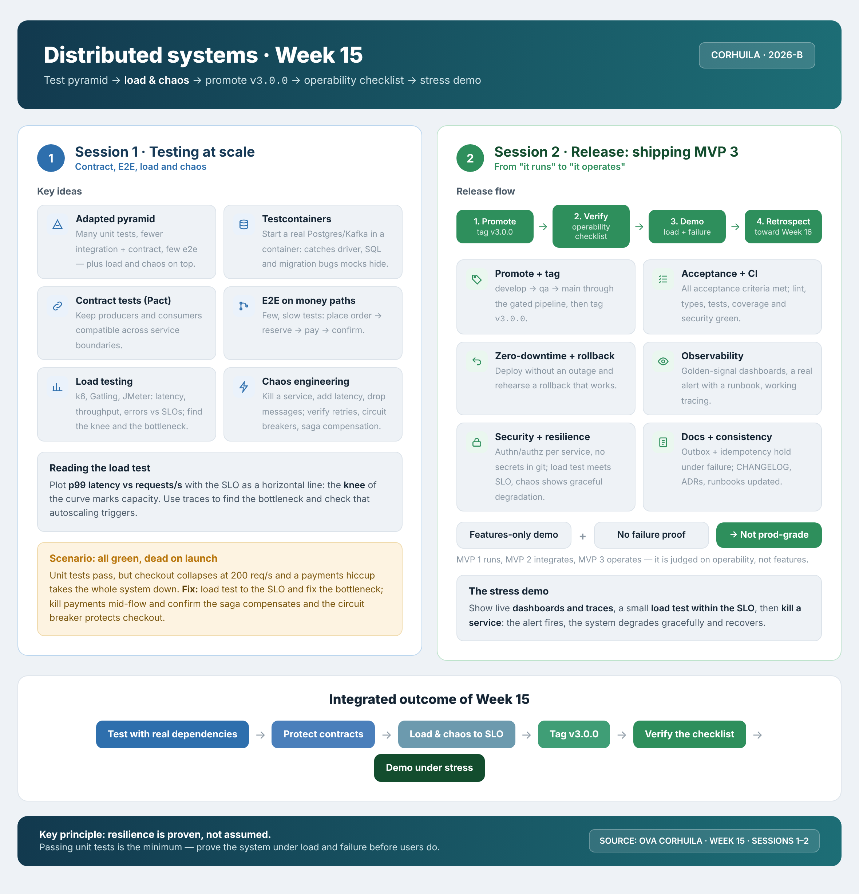

<!-- HU-STATUS TEMPLATE - do NOT remove the <!-- ... --> markers or the table headers.
     Your weekly grade is read AUTOMATICALLY from this file:
       15-week/hu-status/README.md  (inside YOUR fork). English. -->

# Weekly Status - Week 15

<!-- CONFIG-START - must match your profile repo (username/username) CONFIG -->
- FULL_NAME: Karen Johana Caicedo Arias
- GITHUB_USER: karencaicedo1907
- TEAM: CineSync Platform
- SPRINT_GOAL: Close and publish the release 3.0.0 of the Catalog domain and the platform, add the optional movie trailer link through all the layers, and prepare the Huawei Cloud architecture task.
<!-- CONFIG-END -->

## 1. User stories worked this week
| HU ID | Title | Status (todo/doing/done) | Evidence (PR or commit URL) |
|---|---|---|---|
| HU-CATALOG-001 to 006 | Release 3.0.0 of the Catalog service (API and database) | done | Merged to `main`, tag `v3.0.0`. https://github.com/code-corhuila/csp-catalog-api/pull/56, https://github.com/code-corhuila/csp-catalog-db/pull/16 |
| HU-FE-CATALOG-002 | Release 3.0.0 of the catalog portal on the real catalog API | done | Merged to `main`, tag `v3.0.0`. https://github.com/code-corhuila/csp-catalog-portal/pull/78 |
| PLATFORM-MONGO-ROLES | Release 3.0.0 of the MongoDB instance | done | Merged to `main`, tag `v3.0.0`. https://github.com/code-corhuila/csp-infra-mongo/pull/7 |
| HU-CONCESSIONS-004 | Release 3.0.0 of the Concessions portal (co-owned) | done | Merged to `main`, tag `v3.0.0`. https://github.com/code-corhuila/csp-concessions-portal/pull/56 |
| DEC-015 (n/a) | Optional trailer link of a movie in four layers (database validator, API, portal, documentation) | done | In the release 3.0.0. https://github.com/code-corhuila/csp-catalog-db/pull/31, https://github.com/code-corhuila/csp-catalog-api/pull/110, https://github.com/code-corhuila/csp-catalog-portal/pull/99, https://github.com/code-corhuila/csp-docs/pull/372; release PRs https://github.com/code-corhuila/csp-catalog-db/pull/33, https://github.com/code-corhuila/csp-catalog-api/pull/112, https://github.com/code-corhuila/csp-catalog-portal/pull/101 |
| HU-BOOKING-ADMIN | Admin view of the reservations of all users (gateway route and Booking portal screen) | done | In the release 3.0.0. https://github.com/code-corhuila/csp-api-gateway/pull/43, https://github.com/code-corhuila/csp-booking-portal/pull/93; release PRs https://github.com/code-corhuila/csp-api-gateway/pull/45, https://github.com/code-corhuila/csp-booking-portal/pull/95 |
| PLATFORM-HARDENING (n/a) | Outbox reader grant of the worker, Concessions deploy hardening and migration retry | done | https://github.com/code-corhuila/csp-ticketing-db/pull/24, https://github.com/code-corhuila/csp-worker/pull/80, https://github.com/code-corhuila/csp-concessions-portal/pull/62, https://github.com/code-corhuila/csp-concessions-portal/pull/66, https://github.com/code-corhuila/csp-worker/pull/78 |
| W13-STRIDE | STRIDE threat model Booking to Catalog | done | https://github.com/code-corhuila/csp-docs/pull/286 (merged) |
| W15-HUAWEI | Huawei Cloud task: architecture design note, two ADRs, diagram and presentation material | doing | Local work, no link |

## 2. My individual contribution

### 2.1 Executive summary

This week the **release 3.0.0** of the project was closed. It was published with its tag `v3.0.0` in the 24 code repositories of the project (`csp-docs` is documentation and is not published as a release), and there are no open Pull Requests in the `csp-*` repositories. I closed the release of my domain, Catalog (API, database and portal), the Concessions portal and the MongoDB instance. In parallel I added the optional trailer link of a movie through four layers, each one passing through `develop`, `qa` and the release.

**38 Pull Requests of mine were merged** in 10 repositories:

| Repository | PRs |
|---|---|
| `csp-concessions-portal` | 7 |
| `csp-catalog-portal` | 6 |
| `csp-worker` | 5 |
| `csp-catalog-api` | 4 |
| `csp-catalog-db` | 4 |
| `csp-api-gateway` | 3 |
| `csp-booking-portal` | 3 |
| `csp-ticketing-db` | 3 |
| `csp-docs` | 2 |
| `csp-infra-mongo` | 1 |
| **Total** | **38** |

The team merged 49 Pull Requests in `csp-docs`.

### 2.2 Release 3.0.0 closed by me

| Repository | Release PR | State |
|---|---|---|
| `csp-catalog-api` | [#56](https://github.com/code-corhuila/csp-catalog-api/pull/56) | merged, tag `v3.0.0` |
| `csp-catalog-db` | [#16](https://github.com/code-corhuila/csp-catalog-db/pull/16) | merged, tag `v3.0.0` |
| `csp-catalog-portal` | [#78](https://github.com/code-corhuila/csp-catalog-portal/pull/78) | merged, tag `v3.0.0` |
| `csp-concessions-portal` | [#56](https://github.com/code-corhuila/csp-concessions-portal/pull/56) | merged, tag `v3.0.0` |
| `csp-infra-mongo` | [#7](https://github.com/code-corhuila/csp-infra-mongo/pull/7) | merged, tag `v3.0.0` |

### 2.3 Optional trailer link of a movie (DEC-015)

Four layers, each through `develop`, `qa` and the release 3.0.0:

| Layer | develop | qa | release |
|---|---|---|---|
| Database validator (`csp-catalog-db`) | [#31](https://github.com/code-corhuila/csp-catalog-db/pull/31) | [#32](https://github.com/code-corhuila/csp-catalog-db/pull/32) | [#33](https://github.com/code-corhuila/csp-catalog-db/pull/33) |
| API (`csp-catalog-api`) | [#110](https://github.com/code-corhuila/csp-catalog-api/pull/110) | [#111](https://github.com/code-corhuila/csp-catalog-api/pull/111) | [#112](https://github.com/code-corhuila/csp-catalog-api/pull/112) |
| Portal (`csp-catalog-portal`) | [#99](https://github.com/code-corhuila/csp-catalog-portal/pull/99) | [#100](https://github.com/code-corhuila/csp-catalog-portal/pull/100) | [#101](https://github.com/code-corhuila/csp-catalog-portal/pull/101) |
| Documentation, DEC-015 (`csp-docs`) | [#372](https://github.com/code-corhuila/csp-docs/pull/372) | - | - |

### 2.4 Other work that reached the release

- **Admin view of all reservations:** a route in the gateway ([#43](https://github.com/code-corhuila/csp-api-gateway/pull/43)) and a screen in the Booking portal ([#93](https://github.com/code-corhuila/csp-booking-portal/pull/93)); both reached the release ([gateway #45](https://github.com/code-corhuila/csp-api-gateway/pull/45), [portal #95](https://github.com/code-corhuila/csp-booking-portal/pull/95)).
- **Outbox reader role of the worker:** I corrected the permission for the worker login in `csp-ticketing-db` ([#24](https://github.com/code-corhuila/csp-ticketing-db/pull/24)) and documented that migration in `csp-worker` ([#80](https://github.com/code-corhuila/csp-worker/pull/80), promoted by [#81](https://github.com/code-corhuila/csp-worker/pull/81) and [#82](https://github.com/code-corhuila/csp-worker/pull/82)).
- **Concessions portal deploy:** anchored CORS origin regex and narrower JSON location ([#62](https://github.com/code-corhuila/csp-concessions-portal/pull/62)) and security headers on the health endpoint ([#66](https://github.com/code-corhuila/csp-concessions-portal/pull/66)).
- **Migration executor of `csp-worker`:** it retries the connection while the database starts ([#78](https://github.com/code-corhuila/csp-worker/pull/78)).
- **Threat model Booking to Catalog:** STRIDE analysis ([csp-docs#286](https://github.com/code-corhuila/csp-docs/pull/286)), merged.

### 2.5 Local work (no link)

- I rebuilt my local development environment with the team's fixes and the 45 checks of the flow passed, with 0 failures. I also fixed the expiration of the service tokens in my local script.
- **Huawei Cloud task:** I prepared the architecture design note, the two ADRs (ADR-C3-01 and ADR-C3-02) and the diagram, plus the study guide and the script of my slides.

### 2.6 Team

- 49 Pull Requests were merged in `csp-docs`: release record, closed stories, runbooks, C4 diagram, test report, STRIDE analysis, risks, technical debt, README and the `up.sh` procedure.

## 3. Blockers and risks
- The Huawei Cloud task is a draft, local work still in preparation: the ADRs, the diagram and the slides have not been published or delivered yet.
- The local environment and the 45-check flow are local evidence only: they are not part of any Pull Request and cannot be verified on GitHub.
- The 3.0.0 release is closed, but any defect found after publication has to go through a new patch release.

## 4. Plan for next week
- Finish and deliver the Huawei Cloud task: design note, ADR-C3-01 and ADR-C3-02, diagram and slides.
- Keep the 45-check flow passing against the released stack.
- Follow the technical debt and risks recorded in `csp-docs` after the release.

## 5. Compliance self-check
- [x] Conventional Commits - `type(scope): summary`
- [x] Per-environment HU branch + PR to that environment (hu-xxx-dev -> develop, ...)
- [x] Testable acceptance criteria
- [x] Tests added/updated (unit / integration)
- [x] DDD / hexagonal boundaries respected (domain has no I/O)
- [x] No secrets; config via environment variables

## 6. Evidence links
- Release 3.0.0: https://github.com/code-corhuila/csp-catalog-api/pull/56, https://github.com/code-corhuila/csp-catalog-db/pull/16, https://github.com/code-corhuila/csp-catalog-portal/pull/78, https://github.com/code-corhuila/csp-concessions-portal/pull/56, https://github.com/code-corhuila/csp-infra-mongo/pull/7
- Trailer link: https://github.com/code-corhuila/csp-catalog-db/pull/31, https://github.com/code-corhuila/csp-catalog-api/pull/110, https://github.com/code-corhuila/csp-catalog-portal/pull/99, https://github.com/code-corhuila/csp-docs/pull/372
- Admin reservations: https://github.com/code-corhuila/csp-api-gateway/pull/43, https://github.com/code-corhuila/csp-booking-portal/pull/93
- Worker and ticketing: https://github.com/code-corhuila/csp-ticketing-db/pull/24, https://github.com/code-corhuila/csp-worker/pull/80, https://github.com/code-corhuila/csp-worker/pull/78
- Concessions portal deploy: https://github.com/code-corhuila/csp-concessions-portal/pull/62, https://github.com/code-corhuila/csp-concessions-portal/pull/66
- Threat model: https://github.com/code-corhuila/csp-docs/pull/286

### Week 15 summary session 1-2:

