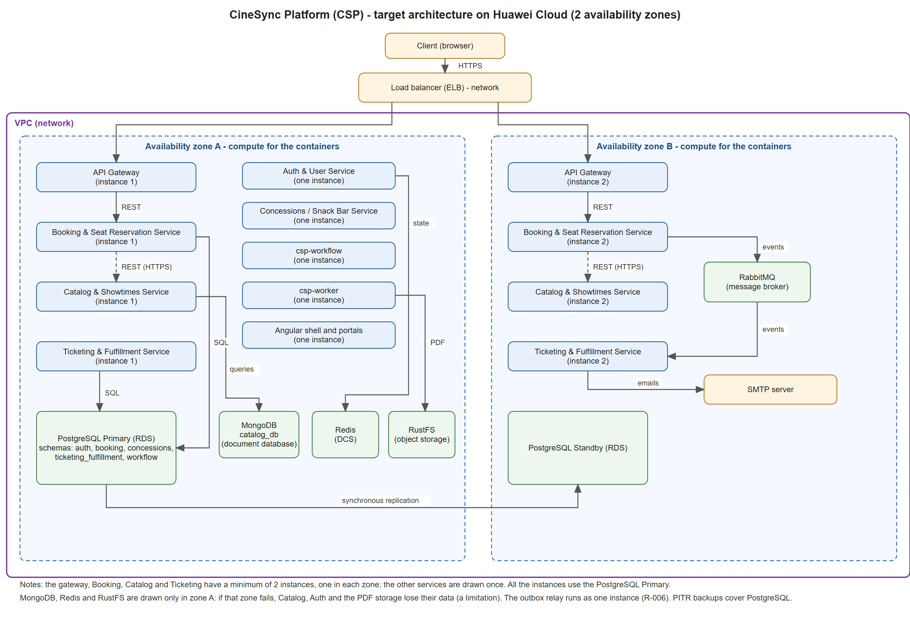

# Architecture design note — CineSync Platform

## 1. Target architecture

| Component | Role | File in `csp-docs` |
|---|---|---|
| API Gateway | Receives all the requests on port 8000 and sends them to the correct service. | `09-microservices/services/01-api-gateway/` |
| Auth & User Service | Manages user accounts and JWT tokens. It uses Go and PostgreSQL. | `09-microservices/services/02-auth-service/` |
| Catalog & Showtimes Service | Manages movies, rooms and showtimes. It uses Spring Boot and MongoDB. | `09-microservices/services/03-catalog-service/` |
| Booking & Seat Reservation Service | Manages seat holds and reservations. It uses PostgreSQL. | `09-microservices/services/04-booking-service/` |
| Concessions / Snack Bar Service | Manages products and snack orders. It uses PostgreSQL. | `09-microservices/services/06-concessions-service/` |
| Ticketing & Fulfillment Service | Creates tickets, PDF files and sends emails. It uses PostgreSQL. | `09-microservices/services/05-ticketing-fulfillment-service/` |
| RabbitMQ | Sends messages between services when events happen. | `05-architecture/decisions/records/ADR-036-rabbitmq-instance-for-the-domain-events.md` |
| Redis | Stores temporary data used by Auth. | `05-architecture/decisions/records/ADR-028-redis-instance-for-the-auth-state.md` |
| `csp-worker` | Checks the outbox and runs background tasks. | `05-architecture/decisions/records/ADR-019-outbox-relay-read-only-for-other-domains.md` |
| `csp-workflow` | Manages the steps of the book-seats process. | `05-architecture/decisions/records/ADR-065-workflow-saga-state-in-postgresql.md` |
| RustFS | Stores ticket PDF files in private storage. | `05-architecture/decisions/records/ADR-058-object-storage-for-the-ticket-pdf-rustfs.md` |
| Angular shell and portals | Provides the web pages that users use to access the system. | `05-architecture/decisions/records/ADR-022-front-end-angular-native-federation.md` |
| SMTP server | Sends emails from Ticketing. | `05-architecture/overview.md` (container diagram) |
| PostgreSQL | Stores data for Auth, Booking, Concessions, Ticketing and Workflow. Each environment has its own database instance. | `05-architecture/decisions/records/ADR-006-environment-level-database-instances.md` and `ADR-065-workflow-saga-state-in-postgresql.md` (schema `workflow`) |
| MongoDB `catalog_db` | Stores Catalog data, like movies, rooms and showtimes. | `05-architecture/decisions/records/ADR-003-polyglot-persistence-strategy.md` |

## 2. Five principles

| Principle | Current weakness | Evidence in -docs | Design decision | Huawei Cloud service |
|---|---|---|---|---|
| **Reliability** | Booking needs Catalog to create a hold. If Catalog is down, users cannot make a reservation. | `ADR-020-booking-catalog-snapshot-and-service-credentials.md` (lines 70 and 90) | Use Catalog in two zones and Booking returns `503` quickly. | ELB |
| **Security** | A person runs the command to sign the tokens, and they last 90 days. | `ADR-052-service-credentials-issuance.md` (D2, D3) | `csp-auth` creates the tokens and they last a short time. This is ADR-C3-01. | DEW |
| **Performance efficiency** | Load tests were not done because there is no staging environment. | `04-requirements/non-functional.md` (NFR-001) and `open-questions.md` (Q-008) | Use scaling from Section 3 and run k6 tests in QA before the first release. | Auto Scaling |
| **Cost** | According to ADR-006, each environment has its own database, so dev and QA cost almost the same as production. | `ADR-006-environment-level-database-instances.md` (Decision, point 1) | Use smaller databases in dev and QA, and use Standby only in production. | Cost Center |
| **Operations** | The outbox relay runs with only one instance and without a lock. | `15-project-control/risks.md` (R-006, line 49) and `open-questions.md` (Q-005) | Use one instance, alerts for backlog and DLQ, and an inbox to ignore duplicate events. | Cloud Eye and LTS |

## 3. Scalability

| Service | Metric | Threshold | Minimum instances | Maximum instances |
|---|---|---|---|---|
| **Booking & Seat Reservation Service** | Average CPU | 70% for 5 minutes | 2 | 6 |
| **Ticketing & Fulfillment Service** | Average CPU | 70% for 5 minutes | 2 | 4 |

Booking needs more resources when many people try to book seats, for example, during a movie release. Ticketing needs more resources when many events are waiting because processing these events uses more CPU.

The minimum is 2 instances because there are two availability zones. The maximum for Booking is 6 because more instances also mean more connections to PostgreSQL. These numbers are my design proposal.

Huawei Auto Scaling will add or remove instances using alarms.

## 4. Disaster recovery

- **Critical data store:** Booking reservations in PostgreSQL.
- **RTO:** 30 minutes.
- **RPO:** 5 minutes.
- **DR pattern:** RDS for PostgreSQL from Huawei Cloud with one Primary and one Standby in two different availability zones, plus PITR.

**Why this pattern meets those numbers:**

The Standby is already synchronized with the Primary, so there is no need to restore the database, and the 30 minutes also include starting the services and processing the pending outbox events.

PITR helps recover the database with a maximum data loss of 5 minutes because Huawei Cloud RDS for PostgreSQL supports incremental backups every 5 minutes.

## 5. Automated deployment

| Stage | Trigger | Tool or service | File in your team's repositories |
|---|---|---|---|
| **Build** | Pull request to `develop`, `qa` or `main`, or manual run | GitHub Actions | `csp-booking-api/.github/workflows/ci.yml` |
| **Test** | After build | GitHub Actions and tests | `csp-booking-api/.github/workflows/ci.yml` |
| **Image** | After tests | Docker | `csp-booking-api/deploy/Dockerfile` |
| **Deploy to QA** | Promotion from `develop` to `qa` | Pipeline of the design (`csp-qa` namespace) | `csp-docs/10-devops/ci-cd.md` |
| **Deploy to production** | Manual approval and promotion from `qa` to `main` | `kubectl rollout` | `csp-docs/10-devops/ci-cd.md` |
| **Rollback** | A check fails after production deployment | `kubectl rollout undo` | `csp-docs/10-devops/ci-cd.md` |

Build and test are already implemented. The image is built but it is not published. QA, production and rollback are still part of the design.

## 6. Decisions

- [ADR-C3-01](ADR-C3-01.md): `csp-auth` creates the service tokens, so a person does not sign them by hand.
- [ADR-C3-02](ADR-C3-02.md): Booking uses a Primary and a Standby in two zones, plus PITR, to recover its reservations.
